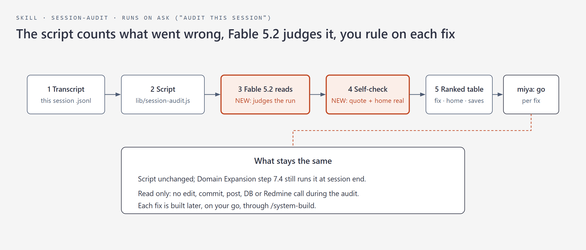

# session-audit — audit one session's run, on ask

The mechanical half already exists: `lib/session-audit.js` (Tool, also run at Domain Expansion step 7.4). This skill starts it on ask and adds the judgment half: one highest-model agent reads the run.



## Steps

| # | Step | Command / detail |
|---|---|---|
| 1 | Find the transcript. This session = the `.jsonl` named by the session id under `~/.claude/projects/<folder slug>/`; another session = the path he gives. | none found: the script's own default (newest of this folder) |
| 2 | Run the script, save its output to the scratchpad. | `node lib/session-audit.js --transcript <path>` → keep the `SESSION-AUDIT:` line |
| 3 | Launch ONE agent, model `fable` (`node lib/models.js highest`), in the background, with the prompt below. Keep working; never predict its result. | Agent tool, `model: "fable"`, `run_in_background: true` |
| 4 | Self-audit against the goal: every row's quote is grepped in the `.jsonl` and every Home path is checked on disk before it is shown (CLAUDE.md Delegation Economy discipline 4). A row that fails either is dropped and named. | `Select-String -SimpleMatch` on the transcript · `Test-Path` on the home |
| 5 | Reply: the `SESSION-AUDIT:` line · the agent's class verdicts · the ranked table · a Next steps row per fix he must rule on. | each fix is built only on his go, through `/system-build` |

## Agent prompt (fill the three paths)

```text
You are auditing ONE finished Claude Code session of an assistant ("Ruri") that works for a developer ("miya"). Goal: find what in this session's RUN can be improved so the next session is faster, cheaper and makes fewer mistakes. READ ONLY: do not edit, write, commit or post anything; do not run any database or Redmine call.
Inputs:
- Transcript (JSONL; never Read it whole, extract with node or PowerShell: user prompts, assistant text, tool_use names + inputs, tool_result is_error, hook attachments): <TRANSCRIPT>
- Mechanical audit already run: <SCRIPT OUTPUT FILE>. Do NOT repeat its rows as findings; judge each class real or noise in one line.
- The system's rules: <MAIN FOLDER>\.claude\CLAUDE.md (Disposition rules 0-11) and the skills under .claude\skills\. Map: system\INDEX.md.
Look for, with evidence: 1 wrong paths and rework (a guess that cost turns, the earlier check that would have saved it) · 2 miya's corrections or repeated asks, verbatim, and the step that should have made the right output · 3 hook or gate friction (blocks, false positives, skip tokens) · 4 wasted spend (large or repeated reads, empty tool calls, agents that did not pay) · 5 asked when it should have acted (rule 7), or acted where his "post it" was needed · 6 what was done well and should become a standing step.
Output ONLY: A) one line per mechanical class: `<class> — real | noise — <why>`. B) a table, max 10 rows, ranked by time saved: `# | Finding | Evidence (verbatim quote <=20 words + approx turn or time) | Cause step | Smallest fix (inside the part that already exists) | Home (file path) | Saves`. C) max 3 lines: what to KEEP doing. Mark anything unverified UNVERIFIED. No new gates, files or flags unless no existing part can hold the fix; say so if so.
```

## Limits

- The agent reads shape and quotes; a row it cannot back with a quote is UNVERIFIED, never a finding.
- The script's classes are counts, not verdicts: `query-miss` includes 0-row checks that were the right answer.
- state-scoped: no, state-agnostic (reads a transcript only).

**Banned**: fixing anything inside the audit turn without his go · showing a row not checked against the transcript · reading a multi-MB transcript whole.

symptom: 2026-11-17 miya: Have we built a skill to start auditing a session's run? If not just do it
goal: every audited session comes back as one ranked table of fixes, each with its home, so the next session repeats none of them
goal_signal: the reply carries the SESSION-AUDIT line and a ranked table whose rows each name a home file
retention: keep
footprint: on-demand: 1 node process under 5 seconds plus 1 highest-model agent per ask; nothing at boot, per prompt or per session
self_audit: step 4, every row's quote grepped in the transcript and its home checked on disk before the reply
boundary: covers one session transcript and the script's output · never edits, commits, posts or runs a DB or Redmine call during the audit · stops at the ranked table; each fix is built only on miya's go through /system-build
