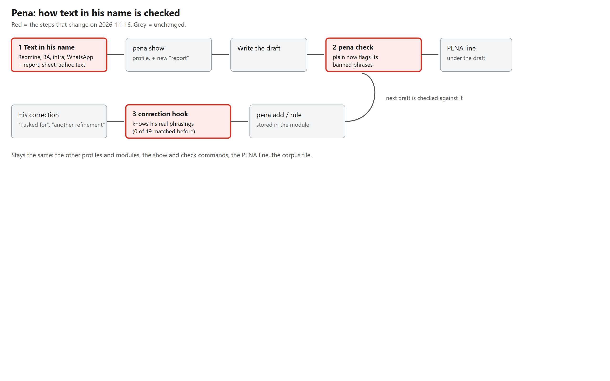
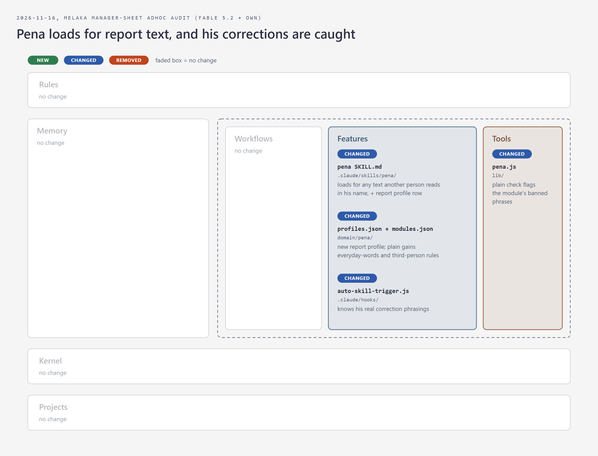

**Last Activity (/arabic: class Lesson 15-16 + sentence table + warm-up built)**: 2026-11-17 23:54 — worktree `arabic-1b6669` (branch claude/arabic-refresh-exercise-9ee6e2). Live class Lesson 15 Ex 7 → Lesson 16 page 95, class closed (journal line written). Engine: ONE sentence table per ayat, 3 rows (role on top, Arabic, makna; first word rightmost), no baris row, no reasons table; new `warmup` command (read without harakat · 3 words · 3 baris · 3 pointer words, score /10 + streak); eval 116/116. Data: baharu→baru everywhere, class words maktab = pejabat, funduq = pondok, word meanings (ms) on 15 rows. Open: Lesson 15/16 ayat not entered into sentences.json (reading round uses Lesson 13 only); phone app with reminders parked by miya ("another time").

## Session Recap (2026-11-17, /arabic)
- Asked: refresh + exercise before class; per-word table in his drawn layout; follow live class; save; build a pre-class warm-up; DE.
- Done: sentence table rebuilt to his layout and trimmed on his word (3 rows); class-along tables per numbered item; class Lesson 15 Ex 7 to Lesson 16 p.95 logged and closed; teacher words saved; warmup built + SKILL row.
- Open: enter Lesson 15/16 ayat (Ayat walk rule 4) so warmup reads the latest class; phone card app (parked).
- Mistakes: pasted the old row-per-word table though he had specified the across layout (2026-11-10); built two tables then misread his "that table" praise; split question/answer into two tables; cut Ex 2 at the page break (items 16-19 missed); "baharu" used; asked "which line is wrong" three times when he only meant next section; Arabic put in a bullet.
- Assessment: A1 his format now lives in the engine (renderSentence), not in my memory. A2 ⏭ no quest. A3 ⏭ no debugging. A4 ⏭ no etanah work. A5 ⏭ no sweep.

**Last Activity (#289819 TRG PT owner Syer empty → handed to ummi)**: 2026-11-17 15:50 — worktree `pelupusan-1-10-baseline-4927df` (branch claude/redmine-issue-289819-a78938). TRG PROD PTTRG/07/01/L/PT/2026/100 → HSBM 07MH1480/2026: Rekod Ketuanpunyaan empty because the owner Syer is NULL on the PLP pemohon row 11820775 AND on the Pendaftaran copy 12035908 (1 of 44,906 copies in 2026). Patch `2. Fix\289819.sql` (Syer 1/1, 2 rows, schema-checked on PROD), picture `3. Diagram - working vs failing.png`; miya submitted the note 07:47 (Resolved By him, 100%). Open: ummi runs the script on PROD; why PSSHS Hantar saved no Syer is unknown (no log line). TRG repos pulled in both places (pelupusan +63, awam +56, common +39); 6 other TRG repos refused by GitLab.

## Session Recap (2026-11-17, #289819 TRG)
- Asked: help TRG on #289819; audit by Fable 5.2 before proceeding; use the PROD server logs; fill and stage Redmine; DE.
- Done: cause proven (DB + Pelupusan code `PelupusanPendaftaranService.java:197-220` + PROD logs: PSSHS 16:21:44, integration copy 16:24:38, draft in etanah-pendaftaran-landed); first script wrong (PLP row only), fixed after the audit found the Pendaftaran copy row; history check: 2 alters (#280438) + 2 patches (#278815, #285970), none touch Syer; Redmine fields + note staged, submitted by miya.
- Open: patch run by TRG; GitLab access for 6 TRG repos; todo items (logs at Phase 0, permohonan history at Phase 0, PROD-SERVER-LOGS TRG layout in the main checkout).
- Mistakes: patch aimed at the wrong row until the audit; logs fetched late and one module (pendaftaran_landed) missed; stored SFTP logins not used until re-pasted; straight-line ad-hoc HTML pictures instead of the diagram-design template and the working-vs-failing fork; pictures dropped for 4 stops; asked him to approve a Submit he owns.
- Assessment: A1 the Fable audit caught the wrong-row patch (good use). A2 Phase 0 has no permohonan-history line and no module-log fetch. A3 1-of-44,906 count settled the cause fast. A4 TRG Pendaftaran copies owners at SPI via the Pelupusan integration (knowledge). A5 ⏭ no sweep.

**Previous Last Activity (ADHOC-PPJK-2026-2 / #281324 PPJK Bukti Penyampaian + adhoc workflow fix)**: 2026-11-17 11:40 — worktree `adhoc-issues-prep-f5ea9c`. Staging + MLIT patched (5 missing PPJK codes, 3 tables each), PPJK/2026/2 and /3 continued, #281324 updated by miya with 281324-PROD.sql + 281324-TRAINING.sql; MLIT PGSJT dates patched (PT/2026/23 → 2026-11-05 15:50:11, PLPS/2026/7 → 2026-10-30 15:50:11). System: adhoc-save + script-check if/else steps, redmine-upload-path blocks ADHOC- names (d0b6368e, GitHub main 5143e516, eval 15/15). Open: PROD + Training scripts via infra/TSO.
**Last Activity (ADHOC-PPJK-2026-2 / #281324 PPJK Bukti Penyampaian + adhoc workflow fix)**: 2026-11-17 11:40 — worktree `adhoc-issues-prep-f5ea9c`. Staging + MLIT patched (5 missing PPJK codes, 3 tables each), PPJK/2026/2 and /3 continued, #281324 updated by miya with 281324-PROD.sql + 281324-TRAINING.sql; MLIT PGSJT dates patched (PT/2026/23 → 2026-11-05 15:50:11, PLPS/2026/7 → 2026-10-30 15:50:11). System: adhoc-save + script-check if/else steps, redmine-upload-path blocks ADHOC- names (d0b6368e, GitHub main 5143e516, eval 15/15). Open: PROD + Training scripts via infra/TSO.

## Session Recap (2026-11-16 to 17, ADHOC-PPJK-2026-2 / #281324)
- Asked: BA's PPJK/2026/3 ID lost after tugasan 22 Hantar; insert + alter so BA can test; same for /2; verify patch is enough; Redmine scripts for PROD + Training on the existing ticket; Fable 5.2 audit of my slips + system fix; MLIT PGSJT date patch; DE.
- Done: 5 PPJK codes (BP_SWA_PLP, BP_PBW_PLP, KMPB_PLP, CM_CCSD_PLP, CB_CMN) on stg1/stg2/MLIT; /2 and /3 altered and visible (flag_tgsn_sistem N, as the notis code does after SMPN); no code or Flowable fix needed; scripts in Task folder 407 `2. Fix`; system fix landed (6 if/else steps).
- Open: PROD + Training run by infra/TSO; alter runner cannot see sub-flow tasks (outside repo); Redmine API key typed inline (should come from config).
- Mistakes: patched 2 of 5 codes first; said done before the BA's list showed the tugasan (hidden flag); created new Redmine tickets instead of updating 281324; ADHOC- file names and a one-line script sent; long replies to short questions.
- Assessment: A1 step-3 gate needed the block in the MAIN folder session file, ~6 retries. A2 adhoc Phase 0 never loaded script/Redmine rules (now fixed). A3 visible-list check would have caught the hidden row in one query. A4 sub-flow code inventory per urusan now in FLOWABLE-KNOWLEDGE §16. A5 ⏭ no sweep.
**Last Activity (Release Pelupusan 1.10.0 COMPLETE + reviewer message in the MR step)**: 2026-11-17 10:46 — worktree `pelupusan-1-10-baseline-4927df`. #274615 new fix merged into mlk/release/1.10.0 (e8f769afb2), miya redeployed staging; BAQA passed (4 tickets + Pelupusan and Awam baseline); MR !22 created (reviewer Yih Kit, then Aaron: only Maintainers merge), Aaron merged → origin/mlk/master 4ac8880349; stag-env already holds it; `merge-to-master --check` = release COMPLETE. System: MR step prints his reviewer message (4496e201 / main folder 487be600, eval 41/41, skill F5, reviewers = Aaron + Alex). Open: #281324 PROD SQL (281324-PROD.sql) via infra / Sheet card.

## Session Recap (2026-11-16 to 17, Release 1.10.0)
- Asked: merge the #274615 fix into the release for a staging redeploy; take the passed release to master (MR to Yih Kit, then Aaron); give the reviewer message straight away in his format and make it a step; DE.
- Done: release merge + staging redeploy; MR !22 merged by Aaron (4ac8880349); release COMPLETE; reviewer message printed by release-prep.js after --create-mr / --record-mr (eval M13b), skill F5, Yih Kit dropped from reviewers; Pena example c77.
- Open: #281324 PROD SQL to infra / Sheet; pena corpus c75/c76 of another session uncommitted in the main folder.
- Mistakes: audit-ticket MISSING false alarm (whole-file compare, line check 114/114); headSha stored short; record-mr refused the puncaktegap host; Yih Kit offered as reviewer though he cannot merge (caught by miya); reviewer message given only after he asked twice.
- Assessment: A1 his message format is now printed by the script, not remembered. A2 release phases F + G ran by script end to end. A3 audit-ticket whole-file compare gives false MISSING on merged files. A4 ⏭ no etanah cause work. A5 ⏭ no sweep.

**Previous Last Activity (289425 PRBB Rencana JKBB JT details lost: fix, MLIT test PASS, Resolved to Anis)**: 2026-11-16 13:44 — worktree `melaka-tickets-review-d7524d` (branch claude/melaka-tickets-review-d7524d). Board brief (all Melaka tickets) → 289425 started (New → In Progress 20%) → fix in MlkKertasTemplateForm.java (save JT rows before Jana Semula and before the Selesai reload; +17 lines) → commit 8365043e36 on mlk/internal-issues/289425, int-env baa4c4431d → miya deployed MLIT, test PASS on PTMLK/01/L/PRBB/2026/42 (SaffuanH) → Redmine Resolved to Anis 13:42 (journal #2, PDF + 2 screenshots). System: release-mlk-plp-scope-gate now blocks only the repo on the release branch (55d56a0a, eval 14/14, live in main folder 976d1924). Test scenario standard = format B (Fable 5.2, his pick); build of the gate/skill change queued in todo.

## Session Recap (2026-11-16, 289425)
- Asked: brief all Melaka tickets, start 289425, apply the swept fix, test on server, Redmine handover; fix the release guard clash; local cleanup audit (build after close); pick a test scenario format.
- Done: 289425 fixed, tested (MLIT PASS), Resolved to Anis; MLIT 2026/42 altered for the test (alter half-failed on a DB drop 12:52, repaired via Alter page) and altered back to PYRJKBBPTG (hazizi); release guard fix landed; todo rows: local-clean audit (A1-A4, P1-P4) and test scenario format B.
- Open: 289425 waits BA verify, then Phase 2; local-clean Tool and format-B gate/skill change to build (both in todo Q1); main folder has 2 local commits not on GitHub (976d1924 landed by land-on-main) to reconcile.
- Mistakes: fix applied uncommitted in miya's repo and left there (local-leftover); test scenario format guessed twice (reply-shape); Redmine staging not done right after the test pass, and the Edge Alter page tried before the runner (workflow-skip); MLIT alter half-failed (data-broken).

**Last Activity (Melaka manager sheet adhoc + Pena system change)**: 2026-11-16 15:40 — worktree `sheet-update-process-5e3ba0`. Melaka tab of the manager's Google Sheet written (5 incident rows, 14 strong tickets after a Fable 5.2 audit, elaboration); preview xlsx in Task folder 408. Audit (Fable 5.2 + own): Pena never loaded for report text, correction hook matched 0 of 19 prompts, "we/our" correction never stored. System change: Pena report profile + plain banned check + correction-hook phrasings (evals: pena 62/62, auto-skill-trigger 19/19). Follow-ups in todo Q1 (Pena ids, hook misses, step-3 rider, quest gates in adhoc). Domain Expansion 2026-11-17 10:43.

## Session Recap (2026-11-16 to 17, Melaka manager sheet + Pena system change)
- Asked: Melaka tab of the manager's sheet (plain table, ticket-number lists, one count column, third person, everyday words); then audit the adhoc with Fable 5.2 + own audit, system-change, DE.
- Done: sheet written + preview xlsx in Task folder 408; Pena `report` profile, plain banned-phrase check, 3 correction-hook phrasings (GitHub main = main folder 67ee4407); corpus rows c79, c80.
- Open: todo Q1 "Pena follow-ups from the Melaka sheet audit" (4 items, build only on his ask).

**Last Activity (ADHOC-PRBB-2026-24 + knowledge-first session)**: 2026-11-12 09:40 — worktree `penang-common-null-error-219adf` (branch claude/adhoc-session-standby-c1d1d0). PROD PRBB slaid lines adhoc: cause Microsoft Print to PDF strips; fixed PDF in 2. Fix; system fix landed b7f17eaa (main folder 598a6116): adhoc reads etanah-knowledge index.md first, knowledge-first-gate blocks the first DB query before a knowledge read, staging test by file origin, wrong MLK STAG rule removed.

STEP-3: test scenario shape + status rule Rework sub-status (289376, 274323)
session: 1879c463-c64a-4782-a882-8e26600129e0
his words: "use a better formatting for test scenario please" (order)
cause step: .claude/skills/stop-point-summary/SKILL.md Test Scenario variant · change: 16 lines
new parts: 0
fix or report: fix

STEP-3: redmine-phase1-prefill Step 5 attachments (281324)
session: d2a90df8-1bc0-4e84-b5e5-ede6d65a2283
his words: "why did you not upload all the things needed just now when you prepare the redmine stage?" (order)
cause step: .claude/skills/redmine-phase1-prefill/SKILL.md Step 5 · change: 2 lines
STEP-3: Pena loads for report text, his corrections are caught (Melaka sheet adhoc)
session: e719659a-3170-48f5-994d-182ac1e911b8
his words: "this falls under category of general adhoc but it should still point to OR load my style of writing" (order)
cause step: .claude/skills/pena/SKILL.md:description · change: 14 lines
new parts: 0
fix or report: fix
model: claude-opus-5-5 (fix decided by the Fable 5.2 audit)
shown: domain/pena/diagram.png

CHANGE-CARD (before): Pena loads for report text, his corrections are caught
What: Pena, his writing-style tool, now loads for any text another person reads in his name, including a report or a sheet for his manager.
Why: On 2026-11-16 the Melaka manager sheet was drafted without Pena, and his "met the ticket" and "we/our" corrections were not caught by any check.
How: Report text picks a new report profile, the plain check flags the banned phrases he corrected, and the correction hook knows his real phrasings. 
When: Pena runs on demand before a draft in his name, and the correction hook runs on every prompt.
Where: The Pena skill, its data in `domain/pena/`, `lib/pena.js` and `.claude/hooks/auto-skill-trigger.js` change. 
Where picture = the change map (lib/change-map.js).

CHANGE-CARD (after): Pena loads for report text, his corrections are caught
What: Pena now loads for any text another person reads in his name, a report, sheet, email or general adhoc included, through a new report profile.
Why: On 2026-11-16 the Melaka manager sheet was drafted without Pena, and the correction hook matched 0 of his 19 prompts that day.
How: The plain check flags the phrases he corrected ("met the ticket", "held by QA"), and the correction hook now catches 5 of those 19 prompts with no false fire. 
When: Pena runs on demand before a draft in his name, and the correction hook runs on every prompt.
Where: The Pena skill, `domain/pena/` (profiles, modules, README, eval), `lib/pena.js` and `.claude/hooks/auto-skill-trigger.js` changed, landed as 67ee4407. 
Where picture = the change map (lib/change-map.js).
system-change done (Pena report profile) 2026-11-16: GitHub main = main folder 67ee4407

**Previous Last Activity (sweep + 289337 to Common + /handover + 289329 4 decimals)**: 2026-11-16 11:25 — worktree `redmine-sweep-audit-371861` (branch claude/redmine-sweep-audit-371861). 289329 Resolved to Mira (393a3fac33, int-env 1592cb0efd, MLIT 1.2345 both screens); 289337 Common fix returned 10:46 (common 1.13.0-MLK.beta.patch, test pending); /handover + sweep board-gap fix landed; Domain Expansion.
**Last Activity (sweep + 289337 to Common + /handover + 289329 4 decimals)**: 2026-11-16 11:25 — worktree `redmine-sweep-audit-371861` (branch claude/redmine-sweep-audit-371861). 289329 Resolved to Mira (393a3fac33, int-env 1592cb0efd, MLIT 1.2345 both screens); 289337 Common fix returned 10:46 (common 1.13.0-MLK.beta.patch, test pending); /handover + sweep board-gap fix landed; Domain Expansion.

STEP-3: 289378 audit, six quest steps
session: 8518d2ea redmine-ticket-recommendations-69038f
his words: "shall we do an audit of this session and then system change now?" (question)
fix or report: fix
who pays: on-demand: read once per quest at the step that runs
goal without the part: each step that made a 289378 mistake carries one line so the next quest does not repeat it
model: claude-opus-5-5
shown: C:\Users\Ridhwan\AppData\Local\Temp\claude\49b830161f995f72\8518d2ea-6b80-40ef-bca3-bdeaff045e7d\scratchpad\audit-plan.png

CHANGE-CARD (before): 289378 audit, six quest steps
What: One line is added to each of the six quest, doc-sim and close-phase steps that made a mistake on 289378.
Why: On 2026-11-16 the 289378 quest guessed columns and a branch name, tested on stg1 before MLIT, called an unrun test checked, and left fix files in his repo.
How: The quest flow picture audit-plan.png marks the six steps, each with its one added line.
When: Each line is read at its own step of the next quest, with no new process.
Where: The quest, close-phase and doc-sim skills plus section 6.3 of the Melaka DATABASE.md.
C:\Users\Ridhwan\AppData\Local\Temp\claude\49b830161f995f72\8518d2ea-6b80-40ef-bca3-bdeaff045e7d\scratchpad\change-map-20261117-025049.png
STEP-3: /handover (2026-11-13, 289337)
session: 93665573-efe6-464a-8977-11b4d240af45
his words: "built it" (order)
his earlier words: "I need you to universally remember & invoke a /handover skill to make it more deterministic"
fix or report: fix
who pays: on-demand skill text (a few hand-overs a week) + per-turn rider inside the existing stop-claim-integrity node process, one regex, no new process
goal without the part: fixing the three contradicting lines gives a fix file, but nothing forces the proof split or the pre-staging audit, and he named the skill
model: claude-fable-5-2
fable verdict: go-with-changes (skill v1 = other team only, rider only when a note or file is staged, handoff-load repointed, none: data/config/env only)
cause step: .claude/skills/cross-module-check/SKILL.md verdict row THEIRS · change: 3 lines
new parts: 1 · replaces: the procedure copy in feedback_cross_module_handoff_artifact.md and handoff-load's injected memory body
shown: C:\Users\Ridhwan\AppData\Local\Temp\claude\d38c170e42ee97f5\93665573-efe6-464a-8977-11b4d240af45\scratchpad\handover-plan.png
audit model (popup 2026-11-13, his words): "Fix this rule since it goes against what I requested and had in mind." → the pre-hand-over audit runs on `node lib/models.js highest`; the sweep's "Never Fable" stays for its bulk waves only

CHANGE-CARD (before): /handover
- What: a /handover skill that every hand-over of a cause or fix to another team or module runs before the note is staged.
- Why: on 2026-11-13 the 289337 note to Common stated an unrun cause as fact, had no fix file or audit, and carried a card meant for the manager.
- How: the step 2 flow picture handover-plan.png shows the hand-over check placed between diagnosis and staging.
- When: on a hand-over to another team, and the Stop check runs on any reply that names another team as owner and stages a note or file.
- Where: .claude/skills/handover, domain/ownership-input-check, cross-module-check, domain/handoff-load, domain/pena and two memories, as the change map shows.
  change map: change-map-20261113-034302.png
Where picture = the change map (lib/change-map.js).

STEP-3:
session: dbc2f4b8-f2c2-481f-8712-3029be88e5bc
his words: "Why didn't you send the ticket to Syakir? Ask Fable 5.2 to audit your actions and make it right."
cause step: .claude/skills/handover/SKILL.md:44 self-audit line · change: 1 line
new parts: 0

STEP-3:
session: dbc2f4b8-f2c2-481f-8712-3029be88e5bc
his words: "make it right"
cause step: .claude/skills/handover/SKILL.md:44 self-audit line · change: 1 line
new parts: 0

STEP-3:
session: dbc2f4b8-f2c2-481f-8712-3029be88e5bc
his words: "Did you skip using system change?" (question)
fix or report: fix
who pays: on-demand: one more read-back on a Redmine form, only after a reload
goal without the part: a re-filled handover form posts the note with the Assignee left on miya
model: claude-opus-5-5
shown: handover-refill-flow.png
cause step: .claude/skills/handover/SKILL.md:44 self-audit line · change: 1 line
new parts: 0

CHANGE-CARD (before): handover re-fill after reload
- What: one added sentence in the handover skill's self-audit line that re-fills and reads back every form field after a reload.
- Why: on 2026-11-17 the 288264 note to Syakir went up after a 422 reload with the Assignee still on miya.
- How: the step 2 flow picture handover-refill-flow.png marks step 4, the re-fill after the reload.
- When: at handover step 6, each time the Redmine form is reloaded or re-filled before Submit.
- Where: .claude/skills/handover/SKILL.md only, as the change map shows.
  change map: change-map-20261117-033124.png
Where picture = the change map (lib/change-map.js).

system-change step 3 (waiting for his nod)

STEP-3:
session: dbc2f4b8-f2c2-481f-8712-3029be88e5bc
his words: "Build it" (order: nod for the handover re-fill fix)
fix or report: fix
who pays: on-demand: one more read-back on a Redmine form, only after a reload
goal without the part: a re-filled handover form posts the note with the Assignee left on miya
model: claude-opus-5-5
shown: handover-refill-flow.png
cause step: .claude/skills/handover/SKILL.md:44 self-audit line · change: 1 line
new parts: 0

system-change step 4 (nod given: Build it)

CHANGE-CARD (after): handover re-fill after reload
- What: one sentence added to the handover skill's self-audit line now re-fills and reads back every form field after a reload.
- Why: on 2026-11-17 the 288264 note to Syakir went up after a 422 reload with the Assignee still on miya.
- How: the step 2 flow picture handover-refill-flow.png marks step 4, the re-fill after the reload.
- When: at handover step 6, each time the Redmine form is reloaded or re-filled before Submit.
- Where: .claude/skills/handover/SKILL.md line 44 only, landed on main as c1721612, as the change map shows.
  change map: change-map-20261117-034002.png
Where picture = the change map (lib/change-map.js).

system-change done: GitHub main c1721612 = main folder c1721612 · watch wmwk56jgo

STEP-3: rename /system-change to /system-build
session: 385118a9-43aa-4544-be2b-9a244f8845fc
his words: "Yes, rename it" (order)
cause step: .claude/skills/system-change/SKILL.md name + its folder, domain/system-change/, the gate readers of the name · change: about 60 lines across 25 files
new parts: 0
fix or report: fix
who pays: on-demand: once for the rename, nothing per system change after
goal without the part: not reachable, he ordered the command renamed (he calls it "system upgrade", wants "system-build")
model: claude-fable-5-2
shown: C:\Users\Ridhwan\AppData\Local\Temp\claude\3751be1afb4b64d4\385118a9-43aa-4544-be2b-9a244f8845fc\scratchpad\change-map-20261117-034237.png
Fable check: go, with five additions (registry.jsonl rows, eval checks S1/G1/G2, both diagrams + map, the paused-route marker, main-memory 1091) and gate line 306 matching both names in both patterns.

CHANGE-CARD (before): rename /system-change to /system-build
What: the change-route Workflow is called /system-build, with the old name kept as a trigger so it still starts.
Why: on 2026-11-17 he asked to rename it ("we should really change the name to be system-build").
How: the same 8 steps in system/INDEX.md run unchanged, shown in the route picture .claude/skills/system-build/diagram.png.
When: on ask, at the start of any change to a part of the seven kinds.
Where: .claude/skills/system-build/ and domain/system-build/, with the gates and rule files repointed, shown in change-map-20261117-034237.png.
Where picture = the change map (lib/change-map.js).

STEP-3: 289378 audit, plan 2 (Templates path)
session: 8518d2ea redmine-ticket-recommendations-69038f
his words: "I want the Quest to be a set of paths that caters different scenarios ... It should really be named Templates" (order)
fix or report: fix
who pays: on-demand: read when a quest runs a template ticket
goal without the part: the quest stays three phases, and a template ticket finds all its rows in one Templates path
model: claude-opus-5-5
shown: C:\Users\Ridhwan\AppData\Local\Temp\claude\49b830161f995f72\8518d2ea-6b80-40ef-bca3-bdeaff045e7d\scratchpad\audit-plan2.png

CHANGE-CARD (before): 289378 audit, plan 2 (Templates path)
What: The template rows spread over the quest skill move into one Templates path section, and the skill gets a boundary line.
Why: On 2026-11-17 he asked for the quest to stay three phases with one path per ticket type, named Templates for template tickets.
How: The picture audit-plan2.png shows the three phases, the three paths and the boundary line.
When: The Templates path is read when a quest runs a template ticket.
Where: The quest skill only.
C:\Users\Ridhwan\AppData\Local\Temp\claude\49b830161f995f72\8518d2ea-6b80-40ef-bca3-bdeaff045e7d\scratchpad\change-map-20261117-034603.png
Where picture = the change map (lib/change-map.js).

CHANGE-CARD (after): rename /system-change to /system-build
What: the change-route Workflow is called /system-build, and the old name and "system upgrade" still start it.
Why: on 2026-11-17 he asked to rename it ("we should really change the name to be system-build").
How: the same 8 steps in system/INDEX.md run unchanged, shown in the route picture .claude/skills/system-build/diagram.png.
When: on ask, at the start of any change to a part of the seven kinds.
Where: .claude/skills/system-build/ and domain/system-build/, with the gates, CLAUDE.md v2.10 and INDEX repointed, shown in C:\Users\Ridhwan\AppData\Local\Temp\claude\3751be1afb4b64d4\385118a9-43aa-4544-be2b-9a244f8845fc\scratchpad\change-map-20261117-035145.png.
Where picture = the change map (lib/change-map.js).

STEP-3: QA-261986 hand-back gap (falsifier-ran-check issue:n + BA example lines; manifest PDF notes, full BA notes, 1) lists)
session: f058be1f-7965-4dae-a902-a985f8c6d784
his words: "Can you run system-upgrade system-change to audit built this and eval and verify and eval it again and scrutinize and run through all verifications." (order)
fix or report: fix
who pays: on-demand: falsifier check at commit, close-phase step 1 and BA note; manifest at quest start and resume
goal without the part: no new part; each ISSUE must be named by a ledger row, each line of the BA's example block is its own ISSUE line, and the manifest reads every PDF note and every line of the newest BA notes
model: claude-fable-5-2 (audit, xhigh) + claude-opus-5-5 (build)
cause step: domain/falsifier-ran-check/check.js:evaluate · change: 33 lines · quest/pdf-annotations.py:47 1 line · lib/redmine-role.js:39 1 line · quest/ticket-load-verify.js BA notes print
new parts: 0

CHANGE-CARD (before): hand-back gap fix (261986)
What: The falsifier check blocks a hand-back while any BA item or any line of her example is unanswered, and the ticket manifest shows every PDF note and every line of her newest note.
Why: On 2026-11-05 ticket 261986 went back Resolved with item 3 still open, and her two-line example was retyped as one line, so it came back on 2026-11-11.
How: The flow picture shows the ledger check at the commit, at close-phase step 1 and at the BA note.
domain/falsifier-ran-check/diagram.png
When: It runs at the etanah commit gate, at close-phase Phase 1 step 1, at the BA pass note and at every quest start or resume.
Where: The parts sit in domain/falsifier-ran-check, the quest skill folder, quest/ and lib/, as the change map shows.
C:\Users\Ridhwan\AppData\Local\Temp\claude\563429ed096014e2\f058be1f-7965-4dae-a902-a985f8c6d784\scratchpad\change-map-20261117-045504.png
Where picture = the change map (lib/change-map.js).

CHANGE-CARD (after): hand-back gap fix (261986)
What: The falsifier check now blocks a hand-back when an ISSUE has no issue:n row or a BA example line is not its own ISSUE line, and the manifest prints every PDF note and every line of her newest note.
Why: On 2026-11-05 ticket 261986 went back Resolved with item 3 still open, and her two-line example was retyped as one line, so it came back on 2026-11-11.
How: The flow picture shows the ledger check at the commit, at close-phase step 1 and at the BA note.
domain/falsifier-ran-check/diagram.png
When: It runs at the etanah commit gate, at close-phase Phase 1 step 1, at the BA pass note and at every quest start or resume.
Where: The changed parts are domain/falsifier-ran-check, the quest skill and template, quest/ticket-load-verify.js, quest/pdf-annotations.py and lib/redmine-role.js, as the change map shows.
C:\Users\Ridhwan\AppData\Local\Temp\claude\563429ed096014e2\f058be1f-7965-4dae-a902-a985f8c6d784\scratchpad\change-map-20261117-045504.png
Where picture = the change map (lib/change-map.js).

STEP-3: protime-plan Baseline default on Monday and Wednesday
session: 385118a9-43aa-4544-be2b-9a244f8845fc
his words: "I guess just add MLK PLP Baseline without version number until it is known (which only happens on the day). I guess we do need a 2 cycle update after all. Build it" (order)
cause step: domain/protime-plan/protime-plan.js morning plan step + settle loop baseline line · change: about 30 lines
new parts: 0
fix or report: fix
who pays: scheduled: the existing 08:30 and 23:00 runs, one extra git read already there
goal without the part: not reachable, the morning run must place the line before the day and the night run must swap or remove it
model: claude-opus-5-5
shown: C:\Users\Ridhwan\AppData\Local\Temp\claude\3751be1afb4b64d4\385118a9-43aa-4544-be2b-9a244f8845fc\scratchpad\protime-baseline-default.png

CHANGE-CARD (before): protime-plan Baseline default on Monday and Wednesday
What: The morning run places MLK PLP Baseline with no number on Monday and Wednesday unless the day is off, and the settle run of that day swaps in the version or removes it.
Why: On 2026-11-17 he asked for the Baseline line by default on its routine days, with the number added only once it is known on the day.
How: The proposal picture protime-baseline-default.png shows the morning placement and the 11 PM keep or remove.
When: At the 08:30 morning run and the 23:00 night run, Monday to Friday.
Where: One file, domain/protime-plan/protime-plan.js, plus its eval and README.
Where picture = the change map (lib/change-map.js).

CHANGE-CARD (after): protime-plan Baseline default on Monday and Wednesday
What: The morning run places MLK PLP Baseline with no number on Monday and Wednesday unless the day is off, already has a baseline line, or had one placed before; the settle run of that day removes it and adds the line with the number when a release branch was worked.
Why: On 2026-11-17 he asked for the Baseline line by default on its routine days, with the number added only once it is known on the day.
How: The part's own picture domain/protime-plan/diagram.png shows the morning placement and the night swap.
When: At the 08:30 morning run and the 23:00 night run, Monday to Friday; first live placement Wednesday 2026-11-18 08:30.
Where: domain/protime-plan (script, eval 143 of 143, README, diagram), GitHub main a00ca1c0, main folder 6a1b5423, watch wmwk9617y.
C:\Users\Ridhwan\AppData\Local\Temp\claude\3751be1afb4b64d4\385118a9-43aa-4544-be2b-9a244f8845fc\scratchpad\change-map-20261117-053030.png
Where picture = the change map (lib/change-map.js).

STEP-3: evidence paper marks only through ts.py highlight (no legend)
session: f058be1f-7965-4dae-a902-a985f8c6d784
his words: "you should not put a fucking legend in the fucking PDF generated. Fix this fucking behaviour in the right steps. Ban it." (order)
fix or report: fix
who pays: on-demand: one line read at the TEMPLATE-SCENARIO hand-back step
goal without the part: no new part; the step that makes a marked paper names the one tool and bans added text
model: claude-opus-5-5
cause step: .claude/skills/quest/SKILL.md:TEMPLATE-SCENARIO row · change: 1 sentence; auto-memory feedback_no_unrequested_fix_photo.md: 1 pointer line
new parts: 0

STEP-3: DE audits quest workflow + etanah-knowledge (254267 goal)
session: melaka-tickets-review-d7524d (ticket 254267)
his words: "Make sure these 2 things are also included in the things we audit every time DE (if it is not yet added specifically/clearly so that it is deterministic)" (order)
fix or report: fix
who pays: Stop hook: banner test on every Stop, real work only on a DE close (about once per session), regex on the transcript already parsed, no child process
goal without the part: A2 and A4 stay prose in Step 7.5, so a DE can close with neither audited and nothing stops it.
model: claude-fable-5-2
shown: C:\Users\Ridhwan\AppData\Local\Temp\claude\24af1f31d5c7a40a\971f936b-7b5e-4e24-8976-29e3d92a0acc\scratchpad\de-c11-flow.png
appraise: A: A2/A4 prose only (expansion-protocol.md:200,202); de-knowledge-gate returns silent with no signal (:144). S: scan all assistant text, not the last block (:71-76); none: <reason> passes for a DE with no ticket or another state. C: de-close-gate is the home for close conditions and runs on every close. Verdict BUILD with changes: C11 in de-close-gate, reuse [skip-de-close-gate:], A4 scope = general or one word.
system-build step 3 (paused, waiting for his nod)

CHANGE-CARD (before): DE audits quest workflow and etanah-knowledge
What: The Domain Expansion close gate also checks that the close carries one quest-workflow line and one etanah-knowledge line.
Why: On 2026-11-17 during ticket 254267 he asked that every Domain Expansion audit both, and today Step 7.5 asks for them in prose only.
How: The flow picture shows the new condition C11 inside de-close-gate at the DE-close banner.
C:\Users\Ridhwan\AppData\Local\Temp\claude\24af1f31d5c7a40a\971f936b-7b5e-4e24-8976-29e3d92a0acc\scratchpad\de-c11-flow.png
When: It runs at every Domain Expansion close, as a Stop hook condition.
Where: The parts sit in domain/de-close-gate and Feature/Domain-Expansion, as the change map shows.
C:\Users\Ridhwan\AppData\Local\Temp\claude\24af1f31d5c7a40a\971f936b-7b5e-4e24-8976-29e3d92a0acc\scratchpad\change-map-20261117-070820.png
Where picture = the change map (lib/change-map.js).

STEP-3: pictures from the diagram-design template only (254267 correction)
session: melaka-tickets-review-d7524d (ticket 254267)
his words: "audit why you didn't use the diagram-design properly and fix this in the CLAUDE.md and every single where everywhere you used this in quest workflow or claude.md or anywhere" (order)
fix or report: fix
who pays: on-demand: one regex pass over the page per render, no new process
goal without the part: a failed self-check can still be forced out with a flag, so hand-made pictures with sentences reach him
model: claude-opus-5-5 (standing nod: his correction; a correction is never held for a model switch)
shown: lib/diagram-render.diagram.png

CHANGE-CARD (before): pictures from the template only
What: The picture renderer refuses a page that fails its check and any box text over 60 characters, and every rule that asks for a picture names the template.
Why: On 2026-11-17 during ticket 254267 three hand-made pictures with sentences in boxes were forced past a failed check, and he could not read them.
How: The flow picture shows a page passing the self-check and the box-text check before a PNG exists.
lib/diagram-render.diagram.png
When: It runs every time a picture is rendered, on demand.
Where: The parts sit in lib, the .claude folder and three skills, as the change map shows.
C:\Users\Ridhwan\AppData\Local\Temp\claude\24af1f31d5c7a40a\971f936b-7b5e-4e24-8976-29e3d92a0acc\scratchpad\change-map-20261117-074526.png
Where picture = the change map (lib/change-map.js).

CHANGE-CARD (after): pictures from the template only
What: The picture renderer now refuses a page that fails its check, refuses the old bypass flag, and fails any box text over 60 characters.
Why: On 2026-11-17 during ticket 254267 three hand-made pictures with sentences in boxes were forced past a failed check, and he could not read them.
How: The flow picture shows a page passing the self-check and the box-text check before a PNG exists.
lib/diagram-render.diagram.png
When: It runs every time a picture is rendered, on demand, and the eval passes 12 of 12.
Where: The parts sit in lib, the .claude folder and three skills, as the change map shows.
C:\Users\Ridhwan\AppData\Local\Temp\claude\24af1f31d5c7a40a\971f936b-7b5e-4e24-8976-29e3d92a0acc\scratchpad\change-map-20261117-074526.png
Where picture = the change map (lib/change-map.js).

system-build step 3 (C11): resumed 2026-11-17 on his nod "This is after Fable 5.2 audit is it? If yes, please build it."

CHANGE-CARD (after): DE audits quest workflow and etanah-knowledge
What: The Domain Expansion close gate now blocks a close that lacks one quest-workflow line and one etanah-knowledge line.
Why: On 2026-11-17 during ticket 254267 he asked that every Domain Expansion audit both, and Step 7.5 asked for them in prose only.
How: The flow picture shows the new condition C11 inside de-close-gate at the DE-close banner.
domain/de-close-gate/diagram.png
When: It runs at every Domain Expansion close, as a Stop hook condition, and its eval passes 64 of 64.
Where: The parts sit in domain/de-close-gate and Feature/Domain-Expansion, as the change map shows.
C:\Users\Ridhwan\AppData\Local\Temp\claude\24af1f31d5c7a40a\971f936b-7b5e-4e24-8976-29e3d92a0acc\scratchpad\change-map-20261117-070820.png
Where picture = the change map (lib/change-map.js).

## Session 2026-11-17 (sheet-update-process-5e3ba0) — QA-261986 rework cycle 6 + hand-back gap fix
Last Activity: 2026-11-17 17:29 · DE run
- 261986: audited why it came back (5 Nov hand-back Resolved with item 3 open, BA example flattened); Fable 5.2 xhigh audit; checked all 12 PSBS Risalat templates against every BA note on MLIT via doc-sim (separate JBoss config E:\Dev\jboss-mlit-261986 -> et_main_mlit, junctions to his JBoss, his untouched); found item 3 table inside a paragraph (Word refused papers); fixed 10 templates + 2 reference docx + Java; commit dad7634374 on mlk/qa/261986v3, int-env merge 9f8d5bf978; Redmine Resolved to Mira #28/#29 16:34 with 14 files; Phase WAIT (BA verify). Worktree E:\Dev\etanah-work\wt-261986 kept.
- System: falsifier-ran-check issue:n + BA example lines (d6f05947); manifest PDF notes + full BA notes + 1) lists; legend ban in quest TEMPLATE-SCENARIO (d82f58fb / main a43e8387); 4 gaps: test table reads archive docs, BA note counts our commits only, --closing, newest int-env merge, rework=cycle-N, sweep Step 6 (599ce2d8 / main b69f3ba6).
- Open: Mira's verify + JPPH answer; staging not deployed; 4 PT Syarikat templates carry the same run-level JT tag (outside 261986); tempoh pajakan asal "-" reaches every urusan; note tool has no draft mode.
Resume: none for this session; 261986 resumes on Mira's reply (qa_doc projects/coding-projects/archive/QA-261986/QA-261986.md, ## Quest Story).

STEP-3: PROD server log = pull ourselves; INT/STG = ask infra
session: 5449e6c0-365f-4cc1-9ef4-3dd6a493f7c5
his words: "if you need PROD server log, you can retrieve it yourself. For internal (staging & internal), we only then we need to ask for infra" (order)
cause step: .claude/skills/quest/SKILL.md:569 Server log of a deployed env · change: 3 lines · new parts: 0
fix or report: fix
who pays: none: wording only, no new part
goal without the part: n/a, no new part
model: claude-opus-5-5
shown: none (wording change of an existing step)

- system-build step 4 (2026-11-20, slip 290431 status stayed New): quest-start claim guards accept quest_start_ts (lib/quest-start-claim.js:52, quest/active-cli.js:120), eval F71-F73 added, stale F34 dropped, README row 36; NOT committed. Waiting Fable 5.2 audit (history + outlier scenarios) before the gate wording fix and landing.

STEP-3:
session: 170e3cd5-40ed-4954-a367-8f851f28bb96
his words: "Please create one and think of where to add this context so that next time you will know where, how, what, why & when to save."
cause step: domain/kpi/kpi.js:effective+render+next command · change: about 22 lines
new parts: 0
fix or report: fix
who pays: on-demand: 1 node process per call, only when miya asks
goal without the part: a next-year row kind inside the existing kpi ledger, no new file
model: claude-opus-5-5
shown: none (in-Feature row kind)

