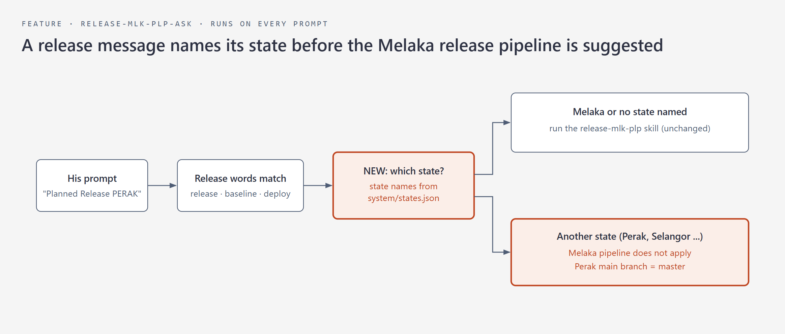
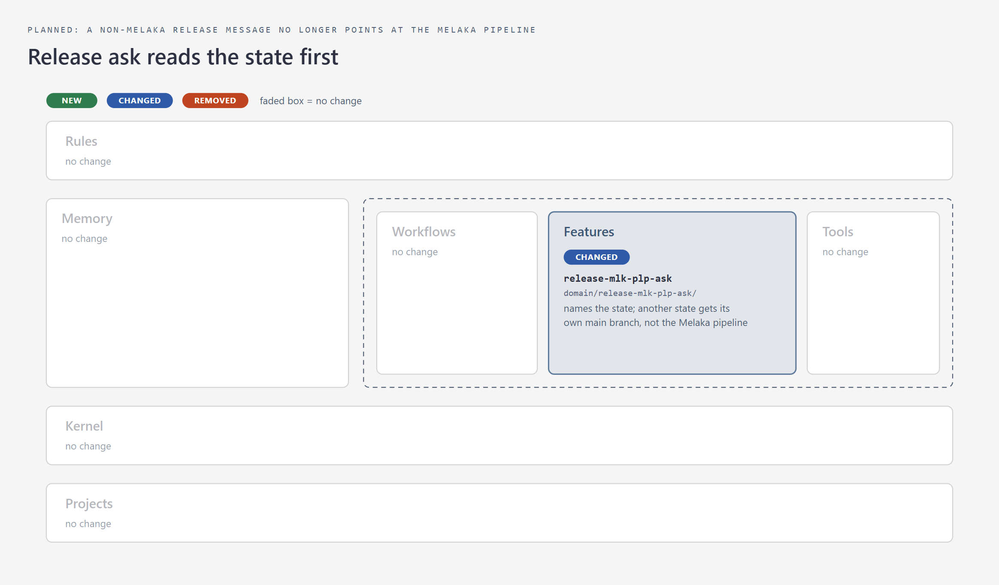

**Last Activity (288625 rework: PROD alter + rework audit; ADHOC-PLBP-2026-2 MLIT permit date)**: 2026-11-13 14:50 — worktree `jovial-kepler-a07ba6` (branch claude/rework-ticket-288625-197057). PROD Initiate & Alter of PTMLK/02/L/PPTPB/2026/5 to SPIL at PTG (norhaslinda.r); done-alter note posted; Redmine now Pending User (TSO, PTG user away on PRN); F1+F2 note-wording fix landed; MLIT permit B01/2026/1 Tarikh Tamat 11/11/2026; Domain Expansion.
system-change step 4 (release-mlk-plp-ask state check) — nod given 2026-11-13: "Yes, build it"

STEP-3: release-mlk-plp-ask reads the state first
session: a0909b1a-576d-463c-b44c-625d579441fb
his words: "I saw you summon mlk's /mlk-release-... but still managed to do it correctly, I am worried this will be an issue in the future, can you audit and check." (order)
fix or report: fix
who pays: every prompt: one extra read of system/states.json only when the release words already matched
goal without the part: a Perak or Selangor release message would still be steered to the Melaka pipeline and mlk/master
model: claude-opus-5-5
shown: domain/release-mlk-plp-ask/diagram.png

CHANGE-CARD (before): release-mlk-plp-ask reads the state first
What: The release-ask hook checks which state a release message names before it suggests the Melaka release pipeline.
Why: On 2026-11-12 a Perak 1.75.7 release message made the hook suggest the Melaka-only pipeline, which targets mlk/master.
How: A release message that names another state gets that state's main branch from the state registry instead of the Melaka pipeline. 
When: It runs on every prompt and acts only when the release words match.
Where: The one hook folder `domain/release-mlk-plp-ask/` changes. 
Where picture = the change map (lib/change-map.js).

**Last Activity (ADHOC-PRBB-2026-24 + knowledge-first session)**: 2026-11-12 09:40 — worktree `penang-common-null-error-219adf` (branch claude/adhoc-session-standby-c1d1d0). PROD PRBB slaid lines adhoc: cause Microsoft Print to PDF strips; fixed PDF in 2. Fix; system fix landed b7f17eaa (main folder 598a6116): adhoc reads etanah-knowledge index.md first, knowledge-first-gate blocks the first DB query before a knowledge read, staging test by file origin, wrong MLK STAG rule removed.

## Session Recap (2026-11-12 to 13, 288625 rework + ADHOC-PLBP-2026-2)
- Asked: resume 288625 rework, solve and close first, audit why it came back, log for session end; then a MLIT patch of permit B01/2026/1 Tarikh Tamat to 11/11/2026; save the adhoc; DE.
- Done: PROD alter (code 1E0F-4C45, his approval): new SPIL a_tgsn 2932270 pejabat_id 1 norhaslinda.r, old SPIL 2866525 Selesai N, header Tamat unchanged (no status patch). Done-alter note posted 12/11 02:33Z; Fizah → Ready in PROD 02:40Z; TSO → Pending User 02:44Z. Rework audit (Fable 5.2): cause = the 06/11 BA note never named the after-release PROD alter (the fix runs at PJ, 2026/5 had passed PJ); wrong-fix row 2 + slip handover-gap. F1 ticket-close-block --alter always ends "Can proceed to verify." (2deb73b8 / main 7e0ece2d, eval 27/27); F2 ALTER-TICKET-PLAYBOOK A6 fill via redmine-phase1-prefill (main folder, untracked). MLIT: umm_a_permit_lesen 16045 trkh_akhir and ind_versi_permit_lesen 6701 trkh_tamat → 2026-11-11 (JDBC, read back); ADHOC-PLBP-2026-2 saved 31/31, A104, archived.
- Open: 288625 waits for PTG user verification in PROD (then Phase 2 archive); TSO Expected ii (No Serahan made at 00) unseen until PTG works SPIL; proposal "after-release PROD action line in BA note" (standing row "given") waits his nod.
- Mistakes: posted "Please help to verify." from the generator without applying his 4 Nov rule's reason; filled Redmine by hand so his screenshot was not attached (slip redmine-note); alter history showed one "Cannot find activity" line not explained.
- Assessment: A1 gates made the 2-line F1/F2 change take ~15 calls (step-3 rider wording, worktree guard on untracked knowledge). A2 rework audit by one Fable agent found the cause in ~2 min. A3 PROD dry run + approval code + AFTER read worked first time. A4 a fix that runs at a step the permohonan already passed needs a named PROD action. A5 ⏭ no sweep.
**Last Activity (ADHOC-PLBP-2026-3, PLBP permit dates one year back for CR 263307 Langkau Tahun)**: 2026-11-13 14:20 — worktree `ba-request-feasibility-906063`. MLIT permit B01/2026/6 (PTMLK/01/L/PLBP/2026/8) patched one year back (3 rows + 2 JSON keys, read back), verified by two code traces + live BPMN; BA proceeded; ProTime adhoc `263307 - Assist patch permit dates for testing`; 4 learning pictures in the Task folder; Domain Expansion.

## Session Recap (2026-11-12 to 13, ADHOC-PLBP-2026-3 Langkau Tahun test data)
- Asked: is the BA's "patch setahun awal" possible so the permohonan can proceed for testing; move the photo to Brief; find the CR the BA tests and add to ProTime; patch it; verify 100% code and DB; add ProTime adhoc; layman pictures of the urusan and tugasan; what the 3 months mean; when Langkau Tahun can be applied; DE.
- Done: CR 263307 (CR - After Go Live, Anis Nabilah); AWAM gate `validateLangkauTahunPLBPMelaka()` needs the latest versi Tarikh Tamat before today; patch run via gateway backend login (psycopg2) 1+1+1 rows; sonnet traces AWAM + Pelupusan both CAN PROCEED; live MLK_PLP_PLBP v2 routes Langkau Tahun to 48.0; ProTime adhoc 41525; pictures 1-4 sent and copied to Task folder 398 `1. Brief`.
- Open: ADHOC-PLBP-2026-3 closing save + archive runs in a background agent after this turn (adhoc-brief-first gate); late Langkau Tahun refusal is a BA business question; the payment step on the Langkau Tahun path is not verified.
- Mistakes: ProTime run blocked by the 2-logins-per-15-min limit and first queued as a plan line before he asked for an adhoc line; the first diagram-render failed the SVG self-check (HTML-only picture).
- Assessment: A1 DE has no step that saves quest pictures (proposal). A2 the adhoc close needs a turn end before the save agent may start, even inside DE. A3 two parallel sonnet traces + one live BPMN read closed the "100%" ask in ~10 min. A4 year-end cap rule now in knowledge. A5 ⏭ no sweep.

**Last Activity (Penang Surat Ulangan JT: common page vs Pelupusan, Papar empty)**: 2026-11-13 10:47 — worktree `mlk-template-surat-ulangan-0122a3`. Penang PRZ/2026/12 Utiliti Penyediaan Surat Papar empty: Papar (`onPaparDoc`) needs a letter status (`s IS NOT NULL`, common 2018); the letter list (`initParentAplikasiDocumentList`) does not. Same code in Melaka and Penang. Domain Expansion.

## Session Recap (2026-11-12 to 13, Penang Surat Ulangan JT)
- Asked: how Melaka gets TemplateSuratUlanganJabatanTeknikal vs Penang (common page); check Penang runtime; PTPNG/01/L/PRZ/2026/12; why onPaparDoc returns nothing; trace; Kedah + Melaka way; patch to test (miya patched himself); does Melaka set status or have a fallback; by requirement should Papar return something; DE.
- Done: Melaka and Penang Pelupusan = same path (UPS_PLP/UPS_PS, pelupusan template, SRTJK_ULGN left out of the common list); Penang's only Ulangan letter came from the Pembangunan utility (UPS_BGN, PSST), which maps SRTJK_ULGN to common surat-SuratJabatanTeknikal.docx. PRZ/2026/12: 4 UPS_PLP attempts 11/11, no letter; letter 4930 SRTJK status_id empty, skg_dok 15435 v1 present. Papar query `findDokumenByAplikasiAndSenaraiJenisDokumenKod` has `s IS NOT NULL`; picker list `findByAplikasiAndJenisDokumenList` has none; Melaka/Kedah/Penang most SRTJK letters have no status; no fallback or status writer in the Ulangan path. Test script (status PERAKU on 4930 + revert) handed; miya runs it.
- Open: miya's test result on UPS_PLP/2026/26; Papar fix belongs to common (load the selected row's letter); note to Pembangunan team not drafted (declined/not asked).
- Mistakes: claimed "status stopped on 21/09" from a partial read (June/July were all null) and corrected; traced Papar for an hour before reading the xhtml binding that shows the list is a different query (read the page binding first).
- Assessment: A1 branch-guard blocks read-only Read on a non-trunk etanah repo (git show used). A2 no quest; adhoc not registered. A3 page binding first, before the backing method. A4 Ulangan list vs Papar fact written to penang WORD-TEMPLATE-RENDERING. A5 ⏭ no sweep.
**Last Activity (ADHOC-PLP-2026-7 GIS service map for Teknikal)**: 2026-11-13 00:51 — worktree `sheet-tugasan-mapping-7b0b01`. Melaka Pelupusan rows 81-89 of the Teknikal sheet "Integrasi Servis Modul" filled, audited twice by Fable 5.2, every cell proven; evidence script, check.sql, 6 guide pictures and a handover prompt for other states in Task folder 399 2. Fix; adhoc-brief-first gate fixed (827f93f2). Domain Expansion.
## Session Recap (2026-11-11, three PROD patch tickets + patch-note generator)
- Asked: /quest the 3 PROD patch tickets; never ask Resolved again; every PROD patch note must list exactly what was patched (all patch types, built with Fable 5.2); fix the wrong 288974 note; keep "Can proceed to verify."
- Done: 288962 alter run with his approval; 288963 + 288974 patched by infra, PROD re-read and verified; all three Resolved to Nurhafizah 100% (read back). redmine-write-gate: standing Resolved rule now fires for a JS status write and when his message says submit (e3dfaa4a, eval 171/171). ticket-close-block --patch prints the note from the .sql itself; script-check rule 9 + patch-script-gate CHECK 8 need a reason per SET column and DELETE (1a99bf39, evals 27/27 + 42/42). Greeting restored (0c46d9ad). 288974 note corrected on Redmine (journal 2588114).
- Found: the 288974 script copied status_keputusan='Batal' and hubungan_aplikasi_id=NULL from 283980 with no reason; the hand-written note then described them wrong. PPTPB/2026/9 link is now null on PROD.
- Open: none. 288974 decided by miya 2026-11-11: link to PPTPB/2026/9 stays removed (PelupusanSuratStrategy reuses a linked UPS_PLP letter, this one was cancelled), Batal kept (15 of 15 ended UPS_PLP on PROD). All three archived at Phase 2 (Redmine Ready in PROD).
- Mistakes: asked for Resolved three times despite his standing rule; hand-wrote the 288974 note from memory; Fable build retired "Can proceed to verify" against his 4 Nov rule.
- Assessment: A1 gate fixes landed same turn, but the step-3 rider blocked edits again (logged, repeat). A2 patch path now generates its handover from the patch. A3 PROD re-read after infra ran caught nothing wrong. A4 copied columns from an analog script without a reason is the root slip. A5 ⏭ no sweep.
**Last Activity (287346 rework 2 session)**: 2026-11-11 21:35 — worktree `hakmilik-pejabat-awareness-32c5c1` (branch claude/ticket-287346-audit-95b5e8). ESOKONGAN 287346 MCL Kertas Pertimbangan PT rework 2: blank page fix pushed and in release 1.9.3; Domain Expansion.

STEP-3: 289265 note generator plain words for MLPS Maksud Pendudukan + per-ID file lines
session: 63893f02-091e-478a-8724-b56060ec0dea
his words: "Please just submit the redmine ticket, infra will run it later anyways. I'll bear the responsibility if infra looked over it. stage redmine please."
cause step: domain/ticket-close-block/ticket-close-block.js:patchGroups · change: 9 lines
new parts: 0

STEP-3: adhoc-brief-first, save-agent detection and one block for all missing items
session: bd30fbfa-5cae-4924-bf32-668fd7c105b8
his words: "If yes, then proceed while we wait for Fable" (order)
cause step: domain/adhoc-brief-first/adhoc-brief-first.check.hook.js:stopCheck · change: 30 lines · new parts: 0
fix or report: fix
model: claude-opus-5-5
shown: abf-fix-flow.png

STEP-3: /handover (2026-11-13, 289337)
session: 93665573-efe6-464a-8977-11b4d240af45
his words: "built it" (order)
his earlier words: "I need you to universally remember & invoke a /handover skill to make it more deterministic"
fix or report: fix
who pays: on-demand skill text (a few hand-overs a week) + per-turn rider inside the existing stop-claim-integrity node process, one regex, no new process
goal without the part: fixing the three contradicting lines gives a fix file, but nothing forces the proof split or the pre-staging audit, and he named the skill
model: claude-fable-5-2
fable verdict: go-with-changes (skill v1 = other team only, rider only when a note or file is staged, handoff-load repointed, none: data/config/env only)
cause step: .claude/skills/cross-module-check/SKILL.md verdict row THEIRS · change: 3 lines
new parts: 1 · replaces: the procedure copy in feedback_cross_module_handoff_artifact.md and handoff-load's injected memory body
shown: C:\Users\Ridhwan\AppData\Local\Temp\claude\d38c170e42ee97f5\93665573-efe6-464a-8977-11b4d240af45\scratchpad\handover-plan.png
audit model (popup 2026-11-13, his words): "Fix this rule since it goes against what I requested and had in mind." → the pre-hand-over audit runs on `node lib/models.js highest`; the sweep's "Never Fable" stays for its bulk waves only

CHANGE-CARD (before): /handover
- What: a /handover skill that every hand-over of a cause or fix to another team or module runs before the note is staged.
- Why: on 2026-11-13 the 289337 note to Common stated an unrun cause as fact, had no fix file or audit, and carried a card meant for the manager.
- How: the step 2 flow picture handover-plan.png shows the hand-over check placed between diagnosis and staging.
- When: on a hand-over to another team, and the Stop check runs on any reply that names another team as owner and stages a note or file.
- Where: .claude/skills/handover, domain/ownership-input-check, cross-module-check, domain/handoff-load, domain/pena and two memories, as the change map shows.
  change map: change-map-20261113-034302.png
Where picture = the change map (lib/change-map.js).

- 2026-11-13 289337 passed to Common (Amirul) with fix file + screenshot; /handover skill built (system-change): procedure moved from quest §Hand-over to ANOTHER TEAM + handoff memory, Stop rider in ownership-input-check (eval 37/37), handoff-load loads the skill (17/17), Pena separate rule (57/57), sweep 'Never Fable' scoped to waves per miya's popup answer.

CHANGE-CARD (after): /handover
- What: a /handover skill that every hand-over of a cause or fix to another team runs, and a Stop check that needs its Handover line when a note or file is staged.
- Why: on 2026-11-13 the 289337 note to Common stated an unrun cause as fact, had no fix file or audit, and carried a card meant for the manager.
- How: the flow picture handover-plan.png shows the hand-over check between diagnosis and staging, now the skill's own diagram.png.
- When: on a hand-over to another team, and the Stop check runs on any reply that names another team as owner and stages a note or file.
- Where: .claude/skills/handover is new, and cross-module-check, quest, sweep, ownership-input-check, handoff-load, Pena and two memories changed, as the change map shows.
  change map: change-map-20261113-040810.png
Where picture = the change map (lib/change-map.js).

STEP-3: redmine-phase1-prefill Step 3 fill method (2026-11-13, 289233/289306)
session: fa7d8874-98b2-4eb4-b7e8-65934894e923
his words: "Yes, add it" (order)
his earlier words: "Why are you still asking to set the status as resolved? Why have you not removed this disease of you keeping on asking something that was already working"
fix or report: fix
who pays: on-demand skill text, read once per Redmine prefill, no process
goal without the part: the skill already says form_input for each field, but nothing says why a script fill makes the gate ask him
model: claude-opus-5-5 (slip fix, not held for a model switch)
cause step: .claude/skills/redmine-phase1-prefill/SKILL.md Step 3 · change: 1 line
new parts: 0
shown: C:\Users\Ridhwan\AppData\Local\Temp\claude\ba2a5e92ecb9cc61\fa7d8874-98b2-4eb4-b7e8-65934894e923\scratchpad\prefill-fill-flow.png

CHANGE-CARD (before): redmine-phase1-prefill Step 3 fill method
- What: one line in the prefill skill Step 3 says Assignee and Status are filled only with form_input and never by a page script.
- Why: on 2026-11-13 a script fill of 289233 and 289306 hid the status from the Redmine gate, so his standing Resolved rule never ran and I asked him.
- How: the step 2 flow picture prefill-fill-flow.png shows the fill step feeding the gate that runs his rule.
- When: the line is read each time the prefill skill fills a Redmine form.
- Where: the folder .claude/skills/redmine-phase1-prefill holds the changed skill, drawn in C:\Users\Ridhwan\AppData\Local\Temp\claude\ba2a5e92ecb9cc61\fa7d8874-98b2-4eb4-b7e8-65934894e923\scratchpad\change-map-20261113-084156.png.
Where picture = the change map (lib/change-map.js).
STEP-3: sweep board gap (2026-11-13)
session: 93665573-efe6-464a-8977-11b4d240af45
his words: "Yes, build it" (order)
fix or report: fix
who pays: on-demand: one extra active.txt read per sweep close, no new process
goal without the part: no new part; two existing steps change
model: claude-opus-5-5
cause step: .claude/skills/sweep/SKILL.md Step 7.2 + domain/sweep/audit.js run() · change: 12 lines
new parts: 0
shown: C:\Users\Ridhwan\AppData\Local\Temp\claude\d38c170e42ee97f5\93665573-efe6-464a-8977-11b4d240af45\scratchpad\board-gap-plan.png

