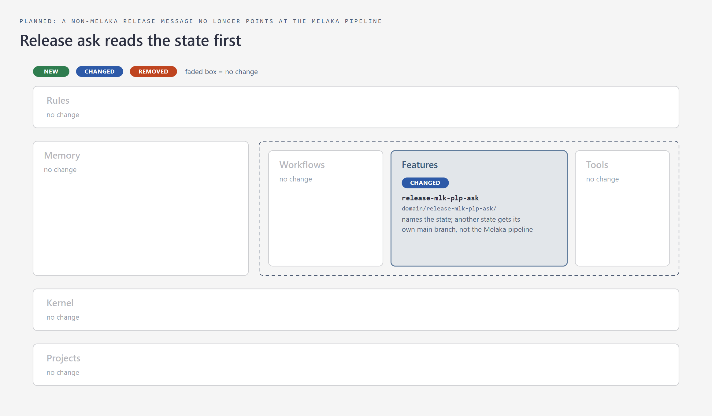

**Last Activity (sweep + 289337 to Common + /handover + 289329 4 decimals)**: 2026-11-16 11:25 — worktree `redmine-sweep-audit-371861` (branch claude/redmine-sweep-audit-371861). 289329 Resolved to Mira (393a3fac33, int-env 1592cb0efd, MLIT 1.2345 both screens); 289337 Common fix returned 10:46 (common 1.13.0-MLK.beta.patch, test pending); /handover + sweep board-gap fix landed; Domain Expansion.

## Session Recap (2026-11-13 to 16, sweep + 289337 + 289329)
- Asked: sweep unswept tickets; stage 289337 to Common; build /handover (fix file + highest-model audit before any hand-over); Redmine sections hold only their own topic; board-gap fix; run 289329 (dynamic decimals D), deploy internal, test data, alter, Redmine stage + submit; DE, save every quest.
- Done: 289337 passed to Common with `2. Fix\DokumenRahsiaService.java`; Amirul returned it 2026-11-16 10:46. /handover skill + ownership-input-check rider (GitHub cc06e23b / main folder 2977c750). Sweep step 7.2 + audit no-board-entry (GitHub e3ba3c91 / main folder 66b6b239). 289329 fix D + h:panelGroup id for the formField label; squashed 393a3fac33; int-env 1592cb0efd; /55 altered SKMMKN and back to PYSK; Redmine journal #3 Resolved to Mira with 2 photos.
- Open: 289337 test with common 1.13.0-MLK.beta.patch on MLIT; 289329 planned-release list; audit why dynamic was not recommended first (after Mira's pass); 289376 / 289378 / 274323 await his pick.
- Mistakes: unproven OTP cause stated as fact; "junior" invented; "1000.0000" stated unverified; fix handed over before rendering (blank page); gate misfires logged.
- Assessment: A1 /handover makes the hand-over audit a step, not a memory. A2 save-quest found 289337 back with us, which the board did not show. A3 the blank page was found by the MLIT error store in one query. A4 et:formField label `for` needs the id in both modes. A5 sweep step 7.2 closes the "Not drafted" board gap.
**Last Activity (TRG 289233 + 289306, Laporan Siasatan Tanah no active file)**: 2026-11-13 17:20 — worktree `sheet-tugasan-mapping-7b0b01` (branch claude/trg-tickets-289233-289306-18fcb0). Both PROD patches run by infra and read back; Redmine Resolved to Nurul Amani with scripts; both quests archived; prefill skill Step 3 fix landed; Domain Expansion.

## Session Recap (2026-11-13, TRG 289233 + 289306)
- Asked: quest two TRG tickets Alex handed over, fix now; stage both Redmine to BA; then why I still asked for Resolved; DE.
- Done: cause = `skg_dok` of `umm_a_dok_keluaran` LPRN_SST_TNH had no active version (v1 off final, v2 off draft); pelupusan tab reads active only. PROD patch v1 flag_aktif Y (LAIN-33656988, LAIN-33011451) by infra, read back. Redmine both Resolved → Nurul Amani, Root Cause (DEV), generated note, .sql + -check.sql. Quests archived (QA docs in projects/coding-projects/archive). Bestiary pattern added. Prefill skill Step 3 form_input only (GitHub d6fcf522 / main folder 0a1cb429).
- Open: 190 other PROD reports in the same state; code fix owner etanah-teknikal (283050 deactivation); hand-over not drafted, he said not now.
- Mistakes: PROD read refused at first (auto mode); filled Assignee/Status by page script so the gate never ran his Resolved rule and I asked him; did not say plainly at first that both tickets were the same issue.
- Assessment: A1 the system-change route for a 1-line skill line took ~15 calls (step-3 rider wording, design-consult, land-on-main dirty file). A2 save-quest + archive-quest + harvest gate closed both cleanly. A3 one active-flag SELECT found the cause before any deep code trace. A4 skg_dok medan_pk_id is shared across medan, filter medan_id. A5 ⏭ no sweep.

**Last Activity (288625 rework: PROD alter + rework audit; ADHOC-PLBP-2026-2 MLIT permit date)**: 2026-11-13 14:50 — worktree `jovial-kepler-a07ba6` (branch claude/rework-ticket-288625-197057). PROD Initiate & Alter of PTMLK/02/L/PPTPB/2026/5 to SPIL at PTG (norhaslinda.r); done-alter note posted; Redmine now Pending User (TSO, PTG user away on PRN); F1+F2 note-wording fix landed; MLIT permit B01/2026/1 Tarikh Tamat 11/11/2026; Domain Expansion.
system-change done (release-mlk-plp-ask state check) 2026-11-13: GitHub main = main folder 9d3707e0

STEP-3: release-mlk-plp-ask reads the state first
session: a0909b1a-576d-463c-b44c-625d579441fb
his words: "Yes, build it" (order)
fix or report: fix
who pays: every prompt: one extra read of system/states.json only when the release words already matched
goal without the part: a Perak or Selangor release message would still be steered to the Melaka pipeline and mlk/master
model: claude-opus-5-5
shown: C:\Users\Ridhwan\OneDrive - Pymsoft Sdn Bhd\0. AI\Project-AI-MemoryCore\.claude\worktrees\pelupusan-1-75-7-merge-defdf7\domain\release-mlk-plp-ask\diagram.png

CHANGE-CARD (before): release-mlk-plp-ask reads the state first
What: The release-ask hook checks which state a release message names before it suggests the Melaka release pipeline.
Why: On 2026-11-12 a Perak 1.75.7 release message made the hook suggest the Melaka-only pipeline, which targets mlk/master.
How: A release message that names another state gets that state's main branch from the state registry instead of the Melaka pipeline. 
When: It runs on every prompt and acts only when the release words match.
Where: The one hook folder `domain/release-mlk-plp-ask/` changes. 
Where picture = the change map (lib/change-map.js).

**Last Activity (ADHOC-PRBB-2026-24 + knowledge-first session)**: 2026-11-12 09:40 — worktree `penang-common-null-error-219adf` (branch claude/adhoc-session-standby-c1d1d0). PROD PRBB slaid lines adhoc: cause Microsoft Print to PDF strips; fixed PDF in 2. Fix; system fix landed b7f17eaa (main folder 598a6116): adhoc reads etanah-knowledge index.md first, knowledge-first-gate blocks the first DB query before a knowledge read, staging test by file origin, wrong MLK STAG rule removed.

STEP-3: redmine-phase1-prefill Step 5 attachments (281324)
session: d2a90df8-1bc0-4e84-b5e5-ede6d65a2283
his words: "why did you not upload all the things needed just now when you prepare the redmine stage?" (order)
cause step: .claude/skills/redmine-phase1-prefill/SKILL.md Step 5 · change: 2 lines
new parts: 0
fix or report: fix

STEP-3: release-mlk-plp-scope-gate checks the branch (289425)
session: 845f0ec9-60aa-4877-b082-7e710ca508f2
his words: "Yes, fix it & proceed what I asked you to do." (order)
cause step: domain/release-mlk-plp-scope-gate/release-mlk-plp-scope-gate.check.hook.js runHook in-flight check ignores the edited repo's branch · change: 8 lines
new parts: 0
fix or report: fix

## Session Recap (2026-11-12 to 13, 288625 rework + ADHOC-PLBP-2026-2)
- Asked: resume 288625 rework, solve and close first, audit why it came back, log for session end; then a MLIT patch of permit B01/2026/1 Tarikh Tamat to 11/11/2026; save the adhoc; DE.
- Done: PROD alter (code 1E0F-4C45, his approval): new SPIL a_tgsn 2932270 pejabat_id 1 norhaslinda.r, old SPIL 2866525 Selesai N, header Tamat unchanged (no status patch). Done-alter note posted 12/11 02:33Z; Fizah → Ready in PROD 02:40Z; TSO → Pending User 02:44Z. Rework audit (Fable 5.2): cause = the 06/11 BA note never named the after-release PROD alter (the fix runs at PJ, 2026/5 had passed PJ); wrong-fix row 2 + slip handover-gap. F1 ticket-close-block --alter always ends "Can proceed to verify." (2deb73b8 / main 7e0ece2d, eval 27/27); F2 ALTER-TICKET-PLAYBOOK A6 fill via redmine-phase1-prefill (main folder, untracked). MLIT: umm_a_permit_lesen 16045 trkh_akhir and ind_versi_permit_lesen 6701 trkh_tamat → 2026-11-11 (JDBC, read back); ADHOC-PLBP-2026-2 saved 31/31, A104, archived.
- Open: 288625 waits for PTG user verification in PROD (then Phase 2 archive); TSO Expected ii (No Serahan made at 00) unseen until PTG works SPIL; proposal "after-release PROD action line in BA note" (standing row "given") waits his nod.
- Mistakes: posted "Please help to verify." from the generator without applying his 4 Nov rule's reason; filled Redmine by hand so his screenshot was not attached (slip redmine-note); alter history showed one "Cannot find activity" line not explained.
- Assessment: A1 gates made the 2-line F1/F2 change take ~15 calls (step-3 rider wording, worktree guard on untracked knowledge). A2 rework audit by one Fable agent found the cause in ~2 min. A3 PROD dry run + approval code + AFTER read worked first time. A4 a fix that runs at a step the permohonan already passed needs a named PROD action. A5 ⏭ no sweep.
**Last Activity (ADHOC-PLBP-2026-3, PLBP permit dates one year back for CR 263307 Langkau Tahun)**: 2026-11-13 14:20 — worktree `ba-request-feasibility-906063`. MLIT permit B01/2026/6 (PTMLK/01/L/PLBP/2026/8) patched one year back (3 rows + 2 JSON keys, read back), verified by two code traces + live BPMN; BA proceeded; ProTime adhoc `263307 - Assist patch permit dates for testing`; 4 learning pictures in the Task folder; Domain Expansion.

STEP-3: release-prep.js prints the reviewer message after the MR is created or recorded (1.10.0)
session: 9a2c82f0-c631-4161-a9c9-87f477e7ce52
his words: "Please use this format moving forward and include in the steps." (order)
cause step: domain/release-mlk-plp/release-prep.js mrCreate + mrRecord print only the link, no message · change: 8 lines
new parts: 0
fix or report: fix
who pays: on-demand: once per release
goal without the part: the reviewer message in his format prints with the MR link, no extra ask
model: claude-opus-5-5
