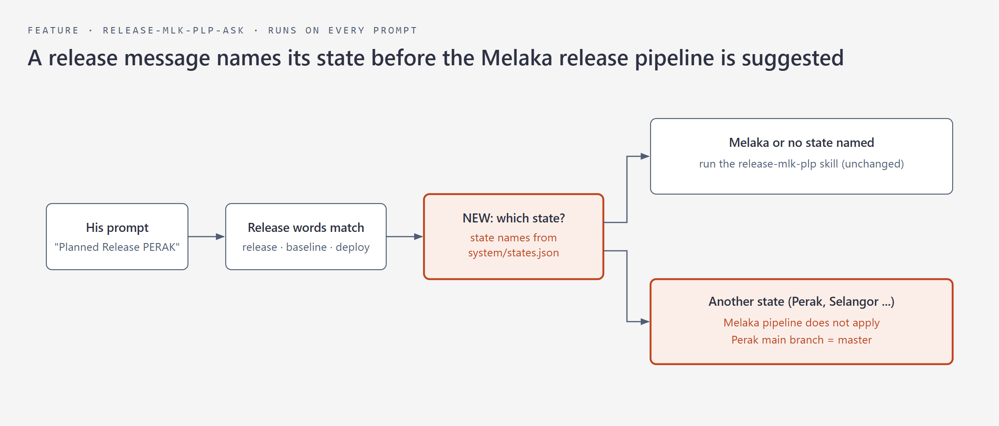

**Last Activity (289425 PRBB Rencana JKBB JT details lost: fix, MLIT test PASS, Resolved to Anis)**: 2026-11-16 13:44 — worktree `melaka-tickets-review-d7524d` (branch claude/melaka-tickets-review-d7524d). Board brief (all Melaka tickets) → 289425 started (New → In Progress 20%) → fix in MlkKertasTemplateForm.java (save JT rows before Jana Semula and before the Selesai reload; +17 lines) → commit 8365043e36 on mlk/internal-issues/289425, int-env baa4c4431d → miya deployed MLIT, test PASS on PTMLK/01/L/PRBB/2026/42 (SaffuanH) → Redmine Resolved to Anis 13:42 (journal #2, PDF + 2 screenshots). System: release-mlk-plp-scope-gate now blocks only the repo on the release branch (55d56a0a, eval 14/14, live in main folder 976d1924). Test scenario standard = format B (Fable 5.2, his pick); build of the gate/skill change queued in todo.

## Session Recap (2026-11-16, 289425)
- Asked: brief all Melaka tickets, start 289425, apply the swept fix, test on server, Redmine handover; fix the release guard clash; local cleanup audit (build after close); pick a test scenario format.
- Done: 289425 fixed, tested (MLIT PASS), Resolved to Anis; MLIT 2026/42 altered for the test (alter half-failed on a DB drop 12:52, repaired via Alter page) and altered back to PYRJKBBPTG (hazizi); release guard fix landed; todo rows: local-clean audit (A1-A4, P1-P4) and test scenario format B.
- Open: 289425 waits BA verify, then Phase 2; local-clean Tool and format-B gate/skill change to build (both in todo Q1); main folder has 2 local commits not on GitHub (976d1924 landed by land-on-main) to reconcile.
- Mistakes: fix applied uncommitted in miya's repo and left there (local-leftover); test scenario format guessed twice (reply-shape); Redmine staging not done right after the test pass, and the Edge Alter page tried before the runner (workflow-skip); MLIT alter half-failed (data-broken).

**Last Activity (Melaka manager sheet adhoc + Pena system change)**: 2026-11-16 15:40 — worktree `sheet-update-process-5e3ba0`. Melaka tab of the manager's Google Sheet written (5 incident rows, 14 strong tickets after a Fable 5.2 audit, elaboration); preview xlsx in Task folder 408. Audit (Fable 5.2 + own): Pena never loaded for report text, correction hook matched 0 of 19 prompts, "we/our" correction never stored. System change: Pena report profile + plain banned check + correction-hook phrasings (evals: pena 62/62, auto-skill-trigger 19/19). Follow-ups in todo Q1 (Pena ids, hook misses, step-3 rider, quest gates in adhoc). Domain Expansion 2026-11-17 10:43.

## Session Recap (2026-11-16 to 17, Melaka manager sheet + Pena system change)
- Asked: Melaka tab of the manager's sheet (plain table, ticket-number lists, one count column, third person, everyday words); then audit the adhoc with Fable 5.2 + own audit, system-change, DE.
- Done: sheet written + preview xlsx in Task folder 408; Pena `report` profile, plain banned-phrase check, 3 correction-hook phrasings (GitHub main = main folder 67ee4407); corpus rows c79, c80.
- Open: todo Q1 "Pena follow-ups from the Melaka sheet audit" (4 items, build only on his ask).

STEP-3: Pena loads for report text, his corrections are caught (Melaka sheet adhoc)
session: e719659a-3170-48f5-994d-182ac1e911b8
his words: "this falls under category of general adhoc but it should still point to OR load my style of writing" (order)
cause step: .claude/skills/pena/SKILL.md:description · change: 14 lines
new parts: 0
fix or report: fix
model: claude-opus-5-5 (fix decided by the Fable 5.2 audit)
shown: domain/pena/diagram.png

CHANGE-CARD (before): Pena loads for report text, his corrections are caught
What: Pena, his writing-style tool, now loads for any text another person reads in his name, including a report or a sheet for his manager.
Why: On 2026-11-16 the Melaka manager sheet was drafted without Pena, and his "met the ticket" and "we/our" corrections were not caught by any check.
How: Report text picks a new report profile, the plain check flags the banned phrases he corrected, and the correction hook knows his real phrasings. 
When: Pena runs on demand before a draft in his name, and the correction hook runs on every prompt.
Where: The Pena skill, its data in `domain/pena/`, `lib/pena.js` and `.claude/hooks/auto-skill-trigger.js` change. 
Where picture = the change map (lib/change-map.js).

CHANGE-CARD (after): Pena loads for report text, his corrections are caught
What: Pena now loads for any text another person reads in his name, a report, sheet, email or general adhoc included, through a new report profile.
Why: On 2026-11-16 the Melaka manager sheet was drafted without Pena, and the correction hook matched 0 of his 19 prompts that day.
How: The plain check flags the phrases he corrected ("met the ticket", "held by QA"), and the correction hook now catches 5 of those 19 prompts with no false fire. 
When: Pena runs on demand before a draft in his name, and the correction hook runs on every prompt.
Where: The Pena skill, `domain/pena/` (profiles, modules, README, eval), `lib/pena.js` and `.claude/hooks/auto-skill-trigger.js` changed, landed as 67ee4407. 
Where picture = the change map (lib/change-map.js).
system-change done (Pena report profile) 2026-11-16: GitHub main = main folder 67ee4407

**Previous Last Activity (sweep + 289337 to Common + /handover + 289329 4 decimals)**: 2026-11-16 11:25 — worktree `redmine-sweep-audit-371861` (branch claude/redmine-sweep-audit-371861). 289329 Resolved to Mira (393a3fac33, int-env 1592cb0efd, MLIT 1.2345 both screens); 289337 Common fix returned 10:46 (common 1.13.0-MLK.beta.patch, test pending); /handover + sweep board-gap fix landed; Domain Expansion.
**Last Activity (sweep + 289337 to Common + /handover + 289329 4 decimals)**: 2026-11-16 11:25 — worktree `redmine-sweep-audit-371861` (branch claude/redmine-sweep-audit-371861). 289329 Resolved to Mira (393a3fac33, int-env 1592cb0efd, MLIT 1.2345 both screens); 289337 Common fix returned 10:46 (common 1.13.0-MLK.beta.patch, test pending); /handover + sweep board-gap fix landed; Domain Expansion.

## Session Recap (2026-11-13 to 16, sweep + 289337 + 289329)
- Asked: sweep unswept tickets; stage 289337 to Common; build /handover (fix file + highest-model audit before any hand-over); Redmine sections hold only their own topic; board-gap fix; run 289329 (dynamic decimals D), deploy internal, test data, alter, Redmine stage + submit; DE, save every quest.
- Done: 289337 passed to Common with `2. Fix\DokumenRahsiaService.java`; Amirul returned it 2026-11-16 10:46. /handover skill + ownership-input-check rider (GitHub cc06e23b / main folder 2977c750). Sweep step 7.2 + audit no-board-entry (GitHub e3ba3c91 / main folder 66b6b239). 289329 fix D + h:panelGroup id for the formField label; squashed 393a3fac33; int-env 1592cb0efd; /55 altered SKMMKN and back to PYSK; Redmine journal #3 Resolved to Mira with 2 photos.
- Open: 289337 test with common 1.13.0-MLK.beta.patch on MLIT; 289329 planned-release list; audit why dynamic was not recommended first (after Mira's pass); 289376 / 289378 / 274323 await his pick.
- Mistakes: unproven OTP cause stated as fact; "junior" invented; "1000.0000" stated unverified; fix handed over before rendering (blank page); gate misfires logged.
- Assessment: A1 /handover makes the hand-over audit a step, not a memory. A2 save-quest found 289337 back with us, which the board did not show. A3 the blank page was found by the MLIT error store in one query. A4 et:formField label `for` needs the id in both modes. A5 sweep step 7.2 closes the "Not drafted" board gap.
**Last Activity (TRG 289233 + 289306, Laporan Siasatan Tanah no active file)**: 2026-11-13 17:20 — worktree `sheet-tugasan-mapping-7b0b01` (branch claude/trg-tickets-289233-289306-18fcb0). Both PROD patches run by infra and read back; Redmine Resolved to Nurul Amani with scripts; both quests archived; prefill skill Step 3 fix landed; Domain Expansion.

## Session Recap (2026-11-13, TRG 289233 + 289306)
- Asked: quest two TRG tickets Alex handed over, fix now; stage both Redmine to BA; then why I still asked for Resolved; DE.
- Done: cause = `skg_dok` of `umm_a_dok_keluaran` LPRN_SST_TNH had no active version (v1 off final, v2 off draft); pelupusan tab reads active only. PROD patch v1 flag_aktif Y (LAIN-33656988, LAIN-33011451) by infra, read back. Redmine both Resolved → Nurul Amani, Root Cause (DEV), generated note, .sql + -check.sql. Quests archived (QA docs in projects/coding-projects/archive). Bestiary pattern added. Prefill skill Step 3 form_input only (GitHub d6fcf522 / main folder 0a1cb429).
- Open: 190 other PROD reports in the same state; code fix owner etanah-teknikal (283050 deactivation); hand-over not drafted, he said not now.
- Mistakes: PROD read refused at first (auto mode); filled Assignee/Status by page script so the gate never ran his Resolved rule and I asked him; did not say plainly at first that both tickets were the same issue.
- Assessment: A1 the system-change route for a 1-line skill line took ~15 calls (step-3 rider wording, design-consult, land-on-main dirty file). A2 save-quest + archive-quest + harvest gate closed both cleanly. A3 one active-flag SELECT found the cause before any deep code trace. A4 skg_dok medan_pk_id is shared across medan, filter medan_id. A5 ⏭ no sweep.

**Last Activity (288625 rework: PROD alter + rework audit; ADHOC-PLBP-2026-2 MLIT permit date)**: 2026-11-13 14:50 — worktree `jovial-kepler-a07ba6` (branch claude/rework-ticket-288625-197057). PROD Initiate & Alter of PTMLK/02/L/PPTPB/2026/5 to SPIL at PTG (norhaslinda.r); done-alter note posted; Redmine now Pending User (TSO, PTG user away on PRN); F1+F2 note-wording fix landed; MLIT permit B01/2026/1 Tarikh Tamat 11/11/2026; Domain Expansion.
system-change done (release-mlk-plp-ask state check) 2026-11-13: GitHub main = main folder 9d3707e0

STEP-3: release-mlk-plp-ask reads the state first
session: a0909b1a-576d-463c-b44c-625d579441fb
his words: "Yes, build it" (order)
fix or report: fix
who pays: every prompt: one extra read of system/states.json only when the release words already matched
goal without the part: a Perak or Selangor release message would still be steered to the Melaka pipeline and mlk/master
model: claude-opus-5-5
shown: C:\Users\Ridhwan\OneDrive - Pymsoft Sdn Bhd\0. AI\Project-AI-MemoryCore\.claude\worktrees\pelupusan-1-75-7-merge-defdf7\domain\release-mlk-plp-ask\diagram.png

CHANGE-CARD (before): release-mlk-plp-ask reads the state first
What: The release-ask hook checks which state a release message names before it suggests the Melaka release pipeline.
Why: On 2026-11-12 a Perak 1.75.7 release message made the hook suggest the Melaka-only pipeline, which targets mlk/master.
How: A release message that names another state gets that state's main branch from the state registry instead of the Melaka pipeline. 
When: It runs on every prompt and acts only when the release words match.
Where: The one hook folder `domain/release-mlk-plp-ask/` changes. 
Where picture = the change map (lib/change-map.js).

**Last Activity (ADHOC-PRBB-2026-24 + knowledge-first session)**: 2026-11-12 09:40 — worktree `penang-common-null-error-219adf` (branch claude/adhoc-session-standby-c1d1d0). PROD PRBB slaid lines adhoc: cause Microsoft Print to PDF strips; fixed PDF in 2. Fix; system fix landed b7f17eaa (main folder 598a6116): adhoc reads etanah-knowledge index.md first, knowledge-first-gate blocks the first DB query before a knowledge read, staging test by file origin, wrong MLK STAG rule removed.

STEP-3: redmine-phase1-prefill Step 5 attachments (281324)
session: d2a90df8-1bc0-4e84-b5e5-ede6d65a2283
his words: "why did you not upload all the things needed just now when you prepare the redmine stage?" (order)
cause step: .claude/skills/redmine-phase1-prefill/SKILL.md Step 5 · change: 2 lines
new parts: 0
fix or report: fix

STEP-3: release-mlk-plp-scope-gate checks the branch (289425)
session: 845f0ec9-60aa-4877-b082-7e710ca508f2
his words: "Yes, fix it & proceed what I asked you to do." (order)
cause step: domain/release-mlk-plp-scope-gate/release-mlk-plp-scope-gate.check.hook.js runHook in-flight check ignores the edited repo's branch · change: 8 lines
new parts: 0
fix or report: fix

STEP-3: release-prep.js prints the reviewer message after the MR is created or recorded (1.10.0)
session: 9a2c82f0-c631-4161-a9c9-87f477e7ce52
his words: "Please use this format moving forward and include in the steps." (order)
cause step: domain/release-mlk-plp/release-prep.js mrCreate + mrRecord print only the link, no message · change: 8 lines
new parts: 0
fix or report: fix

STEP-3: release-mlk-plp-scope-gate checks the branch (289425)
session: 845f0ec9-60aa-4877-b082-7e710ca508f2
his words: "Yes, fix it & proceed what I asked you to do." (order)
cause step: domain/release-mlk-plp-scope-gate/release-mlk-plp-scope-gate.check.hook.js runHook in-flight check ignores the edited repo's branch · change: 8 lines
new parts: 0
fix or report: fix

## Session Recap (2026-11-12 to 13, 288625 rework + ADHOC-PLBP-2026-2)
- Asked: resume 288625 rework, solve and close first, audit why it came back, log for session end; then a MLIT patch of permit B01/2026/1 Tarikh Tamat to 11/11/2026; save the adhoc; DE.
- Done: PROD alter (code 1E0F-4C45, his approval): new SPIL a_tgsn 2932270 pejabat_id 1 norhaslinda.r, old SPIL 2866525 Selesai N, header Tamat unchanged (no status patch). Done-alter note posted 12/11 02:33Z; Fizah → Ready in PROD 02:40Z; TSO → Pending User 02:44Z. Rework audit (Fable 5.2): cause = the 06/11 BA note never named the after-release PROD alter (the fix runs at PJ, 2026/5 had passed PJ); wrong-fix row 2 + slip handover-gap. F1 ticket-close-block --alter always ends "Can proceed to verify." (2deb73b8 / main 7e0ece2d, eval 27/27); F2 ALTER-TICKET-PLAYBOOK A6 fill via redmine-phase1-prefill (main folder, untracked). MLIT: umm_a_permit_lesen 16045 trkh_akhir and ind_versi_permit_lesen 6701 trkh_tamat → 2026-11-11 (JDBC, read back); ADHOC-PLBP-2026-2 saved 31/31, A104, archived.
- Open: 288625 waits for PTG user verification in PROD (then Phase 2 archive); TSO Expected ii (No Serahan made at 00) unseen until PTG works SPIL; proposal "after-release PROD action line in BA note" (standing row "given") waits his nod.
- Mistakes: posted "Please help to verify." from the generator without applying his 4 Nov rule's reason; filled Redmine by hand so his screenshot was not attached (slip redmine-note); alter history showed one "Cannot find activity" line not explained.
- Assessment: A1 gates made the 2-line F1/F2 change take ~15 calls (step-3 rider wording, worktree guard on untracked knowledge). A2 rework audit by one Fable agent found the cause in ~2 min. A3 PROD dry run + approval code + AFTER read worked first time. A4 a fix that runs at a step the permohonan already passed needs a named PROD action. A5 ⏭ no sweep.
**Last Activity (ADHOC-PLBP-2026-3, PLBP permit dates one year back for CR 263307 Langkau Tahun)**: 2026-11-13 14:20 — worktree `ba-request-feasibility-906063`. MLIT permit B01/2026/6 (PTMLK/01/L/PLBP/2026/8) patched one year back (3 rows + 2 JSON keys, read back), verified by two code traces + live BPMN; BA proceeded; ProTime adhoc `263307 - Assist patch permit dates for testing`; 4 learning pictures in the Task folder; Domain Expansion.

STEP-3: release-prep.js prints the reviewer message after the MR is created or recorded (1.10.0)
session: 9a2c82f0-c631-4161-a9c9-87f477e7ce52
his words: "Please use this format moving forward and include in the steps." (order)
cause step: domain/release-mlk-plp/release-prep.js mrCreate + mrRecord print only the link, no message · change: 8 lines
new parts: 0
fix or report: fix
who pays: on-demand: once per release
goal without the part: the reviewer message in his format prints with the MR link, no extra ask
model: claude-opus-5-5

STEP-3: adhoc workflow fix after the ADHOC-PPJK-2026-2 audit (281324)
session: b5a36295-b0b9-4355-a42c-8d9a82fc9e69
his words: "approve, build it" (order)
cause step: .claude/skills/adhoc-save/SKILL.md Daily row 1 + Brief-first step 1 + Adhoc-route bullets; script-check rules 6-7 + master-data; redmine-upload-path decide() · change: 14 lines
new parts: 0
fix or report: fix
model: claude-opus-5-5
shown: adhoc-fix-plan.png

STEP-3: /handover (2026-11-13, 289337)
session: 93665573-efe6-464a-8977-11b4d240af45
his words: "built it" (order)
his earlier words: "I need you to universally remember & invoke a /handover skill to make it more deterministic"
fix or report: fix
who pays: on-demand skill text (a few hand-overs a week) + per-turn rider inside the existing stop-claim-integrity node process, one regex, no new process
goal without the part: fixing the three contradicting lines gives a fix file, but nothing forces the proof split or the pre-staging audit, and he named the skill
model: claude-fable-5-2
fable verdict: go-with-changes (skill v1 = other team only, rider only when a note or file is staged, handoff-load repointed, none: data/config/env only)
cause step: .claude/skills/cross-module-check/SKILL.md verdict row THEIRS · change: 3 lines
new parts: 1 · replaces: the procedure copy in feedback_cross_module_handoff_artifact.md and handoff-load's injected memory body
shown: C:\Users\Ridhwan\AppData\Local\Temp\claude\d38c170e42ee97f5\93665573-efe6-464a-8977-11b4d240af45\scratchpad\handover-plan.png
audit model (popup 2026-11-13, his words): "Fix this rule since it goes against what I requested and had in mind." → the pre-hand-over audit runs on `node lib/models.js highest`; the sweep's "Never Fable" stays for its bulk waves only

CHANGE-CARD (before): /handover
- What: a /handover skill that every hand-over of a cause or fix to another team or module runs before the note is staged.
- Why: on 2026-11-13 the 289337 note to Common stated an unrun cause as fact, had no fix file or audit, and carried a card meant for the manager.
- How: the step 2 flow picture handover-plan.png shows the hand-over check placed between diagnosis and staging.
- When: on a hand-over to another team, and the Stop check runs on any reply that names another team as owner and stages a note or file.
- Where: .claude/skills/handover, domain/ownership-input-check, cross-module-check, domain/handoff-load, domain/pena and two memories, as the change map shows.
  change map: change-map-20261113-034302.png
Where picture = the change map (lib/change-map.js).

- 2026-11-13 289337 passed to Common (Amirul) with fix file + screenshot; /handover skill built (system-change): procedure moved from quest §Hand-over to ANOTHER TEAM + handoff memory, Stop rider in ownership-input-check (eval 37/37), handoff-load loads the skill (17/17), Pena separate rule (57/57), sweep 'Never Fable' scoped to waves per miya's popup answer.

CHANGE-CARD (after): /handover
- What: a /handover skill that every hand-over of a cause or fix to another team runs, and a Stop check that needs its Handover line when a note or file is staged.
- Why: on 2026-11-13 the 289337 note to Common stated an unrun cause as fact, had no fix file or audit, and carried a card meant for the manager.
- How: the flow picture handover-plan.png shows the hand-over check between diagnosis and staging, now the skill's own diagram.png.
- When: on a hand-over to another team, and the Stop check runs on any reply that names another team as owner and stages a note or file.
- Where: .claude/skills/handover is new, and cross-module-check, quest, sweep, ownership-input-check, handoff-load, Pena and two memories changed, as the change map shows.
  change map: change-map-20261113-040810.png
Where picture = the change map (lib/change-map.js).

STEP-3: sweep board gap (2026-11-13)
session: 93665573-efe6-464a-8977-11b4d240af45
his words: "Yes, build it" (order)
fix or report: fix
who pays: on-demand: one extra active.txt read per sweep close, no new process
goal without the part: no new part; two existing steps change
model: claude-opus-5-5
cause step: .claude/skills/sweep/SKILL.md Step 7.2 + domain/sweep/audit.js run() · change: 12 lines
new parts: 0
shown: C:\Users\Ridhwan\AppData\Local\Temp\claude\d38c170e42ee97f5\93665573-efe6-464a-8977-11b4d240af45\scratchpad\board-gap-plan.png

## Session Recap (2026-11-13, ADHOC-PRBB-2026-25 Ganti Hari + etanah-teach Feature)

- ADHOC-PRBB-2026-25 saved (A107, hold, route CR): PROD PRBB/2026/25 Ganti Hari 4 Hari from 04/12 ends 07/12 per the #285532 rule; user wants Sat/Sun skipped; BA's 08/12 matches only the pre-#285532 count.
- system-change step 4: building Feature etanah-teach (layered lessons).

STEP-3: etanah-teach
session: 8c965136-1d47-4e10-8679-0809e99a7cdc
cause step: .claude/skills/etanah-teach/SKILL.md (new procedure, no existing step teaches etanah) · change: 0 lines in existing parts
new parts: 2 · replaces: none: miya asked for a new Feature, "please create a new Feature for our system"
his words: "please create a new Feature for our system to explain as in someone that doesn't understand anything about etanah system" (order)
fix or report: fix
who pays: on-demand: one node call per lesson audit, nothing at boot or per prompt
goal without the part: none; no existing part explains etanah business from zero in layers (brief = ticket start, kowalski = code architecture, explain-diagram = drawing only)
model: claude-opus-5-5 (highest = claude-fable-5-2; on-demand part, not highest-order, so no Fable block needed per change route step 3)
shown: C:/Users/Ridhwan/OneDrive - Pymsoft Sdn Bhd/0. AI/Project-AI-MemoryCore/.claude/worktrees/mlk-template-surat-ulangan-0122a3/domain/etanah-teach/diagram.png
appraise: A = etanah-knowledge already holds most business facts (verified: glossary, SPOC-COUNTER §4, BPMN, requirement index) · S = scope is explain only, never edits code or data · C = missing piece was a saved per-urusan lesson so the next ask is cheap; added as learn/<URUSAN>.md
nod: "Please proceed." (/goal, 2026-11-13)

CHANGE-CARD (before): etanah-teach
What: A new Feature, etanah-teach, explains any etanah urusan, tugasan, rule or ticket issue to someone who knows nothing, from the overview down to the layer the question needs.
Why: On 2026-11-13 miya asked to learn etanah from zero, layer by layer, with the business logic taken from etanah-knowledge and the requirements.
How: The flow picture domain/etanah-teach/diagram.png shows the question, the stop layer, the layers filled top down from knowledge files, the self-audit, and the reply.
When: It runs on ask, when miya says teach me, explain to me or I want to understand, and costs one node call per lesson audit.
Where: The Feature lives in domain/etanah-teach/ with its skill in .claude/skills/etanah-teach/ and each saved lesson in etanah-knowledge/<state>/learn/.
  change map: C:/Users/Ridhwan/AppData/Local/Temp/claude/6068f4a69bb11f75/8c965136-1d47-4e10-8679-0809e99a7cdc/scratchpad/changemap/change-map-20261113-071327.png
Where picture = the change map (lib/change-map.js).

CHANGE-CARD (after): etanah-teach
What: The Feature etanah-teach now explains an etanah urusan, tugasan, rule or ticket issue from zero, layer by layer from L0 eTanah down to the layer the question needs, and saves each lesson per urusan.
Why: On 2026-11-13 miya asked to learn etanah from zero in layers, with the business logic taken from etanah-knowledge and the requirements.
How: The flow picture domain/etanah-teach/diagram.png shows the question, the stop layer, the layers filled top down from knowledge files, the teach.js self-audit, and the reply.
When: It runs on ask through the etanah-teach skill, and costs one node call per lesson audit, nothing at boot or per prompt.
Where: The Feature is in domain/etanah-teach/ with its skill in .claude/skills/etanah-teach/, and the first lesson is etanah-knowledge/melaka/learn/PRBB.md.
  change map: C:/Users/Ridhwan/AppData/Local/Temp/claude/6068f4a69bb11f75/8c965136-1d47-4e10-8679-0809e99a7cdc/scratchpad/changemap-after/change-map-20261113-072734.png
Where picture = the change map (lib/change-map.js).
GitHub main: 85c956d0 · main folder: 9badf5e9

STEP-3: redmine-phase1-prefill Step 3 fill method (2026-11-13, 289233/289306)
session: fa7d8874-98b2-4eb4-b7e8-65934894e923
his words: "Yes, add it" (order)
his earlier words: "Why are you still asking to set the status as resolved? Why have you not removed this disease of you keeping on asking something that was already working"
fix or report: fix
who pays: on-demand skill text, read once per Redmine prefill, no process
goal without the part: the skill already says form_input for each field, but nothing says why a script fill makes the gate ask him
model: claude-opus-5-5 (slip fix, not held for a model switch)
cause step: .claude/skills/redmine-phase1-prefill/SKILL.md Step 3 · change: 1 line
new parts: 0
shown: C:\Users\Ridhwan\AppData\Local\Temp\claude\ba2a5e92ecb9cc61\fa7d8874-98b2-4eb4-b7e8-65934894e923\scratchpad\prefill-fill-flow.png

CHANGE-CARD (before): redmine-phase1-prefill Step 3 fill method
- What: one line in the prefill skill Step 3 says Assignee and Status are filled only with form_input and never by a page script.
- Why: on 2026-11-13 a script fill of 289233 and 289306 hid the status from the Redmine gate, so his standing Resolved rule never ran and I asked him.
- How: the step 2 flow picture prefill-fill-flow.png shows the fill step feeding the gate that runs his rule.
- When: the line is read each time the prefill skill fills a Redmine form.
- Where: the folder .claude/skills/redmine-phase1-prefill holds the changed skill, drawn in C:\Users\Ridhwan\AppData\Local\Temp\claude\ba2a5e92ecb9cc61\fa7d8874-98b2-4eb4-b7e8-65934894e923\scratchpad\change-map-20261113-084156.png.
Where picture = the change map (lib/change-map.js).

CHANGE-CARD (after): redmine-phase1-prefill Step 3 fill method
- What: Step 3 of the prefill skill now says Assignee and Status are filled only with form_input, Assignee first, never by a page script.
- Why: on 2026-11-13 a script fill of 289233 and 289306 hid the status from the Redmine gate, so his standing Resolved rule never ran and I asked him.
- How: the step 2 flow picture prefill-fill-flow.png shows the fill step feeding the gate that runs his rule.
- When: the line is read each time the prefill skill fills a Redmine form.
- Where: the folder .claude/skills/redmine-phase1-prefill holds the changed skill, drawn in C:\Users\Ridhwan\AppData\Local\Temp\claude\ba2a5e92ecb9cc61\fa7d8874-98b2-4eb4-b7e8-65934894e923\scratchpad\change-map-20261113-084156.png.
Where picture = the change map (lib/change-map.js).
system-change landed: GitHub main d6fcf522 · main folder 0a1cb429

## system-change step 2 (2026-11-16, ADHOC-PPJK-2026-2 slips)
- Model: Opus 5.5 orchestrating; Fable 5.2 (claude-fable-5-2) audit agent running on this session slips (ADHOC-PPJK-2026-2, 281324, ADHOC-PLP-2026-8).
- Kinds and homes: Workflow adhoc-save (.claude/skills/adhoc-save/SKILL.md) step 1 Phase-0 subset; Tools script-check / pena; Memory feedback_script_file_naming, feedback_infra_script_schema_env.
- Next: audit result -> flow picture with changed steps -> STEP-3 block -> change card -> miya nod -> build, verify, record, land.

STEP-3:
session: b5a36295-b0b9-4355-a42c-8d9a82fc9e69
his words: "approve, build it" (order)
his earlier words: "now start the Fable 5.2 audit on all of your fucking fuckups during this session. I expect the fucking system fix to be running until you show me the diagram for me to approve" (order)
fix or report: fix
who pays: on-demand: text in two skills read on adhoc and script turns; one string check added to an existing per-upload hook (under 100 ms)
goal without the part: the adhoc workflow itself routes to the BA's ticket, loads the script and style rules at Phase 0, checks every sub-flow code, and calls a fix done only when the user's list shows it
model: claude-fable-5-2 (audit), claude-opus-5-5 (orchestrator)
shown: adhoc-fix-plan.png · change-map-20261116-074550.png
nod: "approve, build it" (2026-11-17)
cause step: .claude/skills/adhoc-save/SKILL.md Daily row 1 + Brief-first step 1 + Adhoc-route bullets; script-check rules 6-7 + master-data; redmine-upload-path decide() · change: 14 lines
new parts: 0

CHANGE-CARD (before): adhoc workflow fix after the ADHOC-PPJK-2026-2 audit
What: The adhoc workflow and the script check get six step changes, and the upload gate refuses a file named with our internal ADHOC id.
Why: On 2026-11-16 the PPJK adhoc patched 2 of 5 codes, said done before the user could see the tugasan, opened new Redmine tickets, and sent scripts named and formatted against the stored rules.
How: The flow picture adhoc-fix-plan.png shows the six changed steps with a thick border.
When: The steps run on every adhoc turn and every script, and the gate runs on every Redmine file upload.
Where: The changes sit in .claude/skills/adhoc-save, .claude/skills/script-check, domain/redmine-upload-path and the Melaka flowable knowledge file, shown in change-map-20261116-074550.png.
Where picture = the change map (lib/change-map.js).
